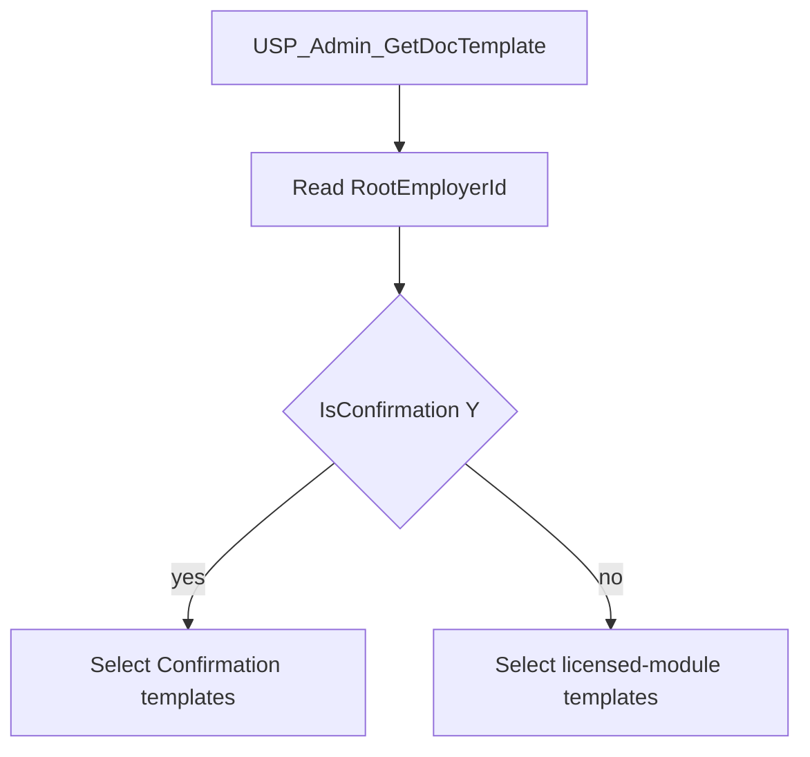

# USP_Admin_GetDocTemplate

## What it does

Returns document templates for one employer. When `@IsConfirmation` is `Y`, it limits rows to Confirmation modules. Otherwise it returns non-deleted templates whose module is still active on the employer's root organization, with category names, access summary, and date-format display name.

## Parameters

| Name | Direction | What it is for |
|---|---|---|
| `@Employerid` | in | Employer whose templates are listed |
| `@Isactive` | in | Optional `IsActive` filter; null returns all |
| `@IsConfirmation` | in | When `Y`, Confirmation-module templates only. Defaults to `N` |

## Call sequence

Calls no other procedures or functions.

## Callers

No other procedure or function calls this object. `DocBuilderDAL.GetAdminDocTemplates` executes it from Doc Builder (`BuilderData.jsx`).

## Nested

Calls no other procedures or functions.

## Steps

1. Resolve `@RootEmployerId` from `TEmployerDetails` for `@Employerid`.
2. When `@IsConfirmation` is `Y`, select from `TDocumentTemplates` for that employer where `ModuleId` is a Confirmation module, applying the active filter and joining `TDateFormatMaster`.
3. Otherwise select distinct templates joined to active `THrmsModules` / `TEmployerModule` for the root employer, rename module 18 to `Offer Rolled Out`, build category and access-permission display strings, and return date-format display name.

## Tables

| Table | Read or write |
|---|---|
| `dbo.TEmployerDetails` | read |
| `dbo.TDocumentTemplates` | read |
| `dbo.THrmsModules` | read |
| `dbo.TEmployerModule` | read |
| `dbo.TAttachmentCategory` | read |
| `dbo.TDateFormatMaster` | read |

## Unresolved calls

None.

## Flow

