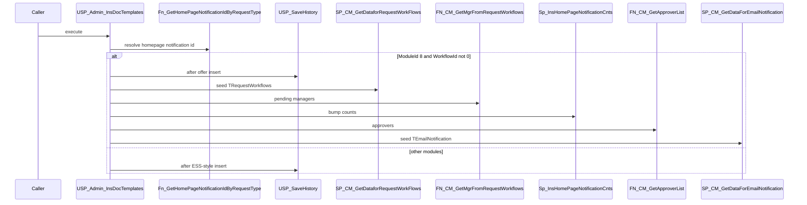
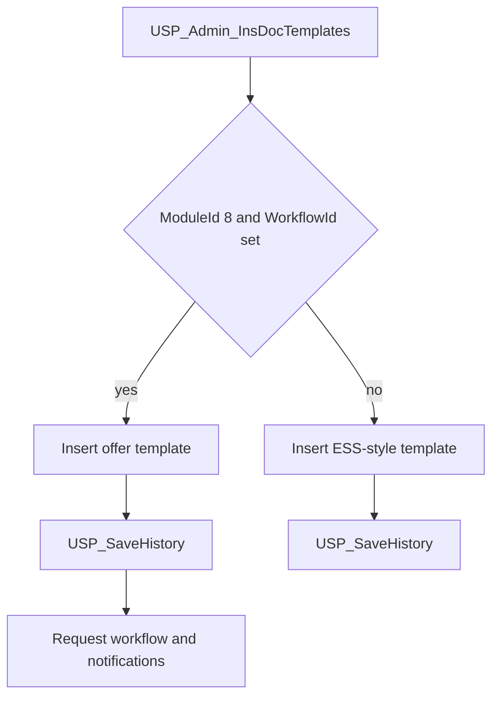

# USP_Admin_InsDocTemplates

## What it does

Inserts one `TDocumentTemplates` row and writes a history snapshot via `USP_SaveHistory`. When `@ModuleId` is 8 and `@WorkflowId` is not 0, it also creates request-workflow rows, homepage notification counts, and an email-notification row for the offer-letter approval path. Otherwise it inserts the fuller ESS-style column set (acceptance, categories, email fields, role/employee access) without workflow side effects.

## Parameters

| Name | Direction | What it is for |
|---|---|---|
| `@DocumentName` | in | Template name |
| `@DocumentDescription` | in | Description |
| `@Templatemodule` | in | Logical module label (`OfferLetter` / `EmployeeLetters`) |
| `@DocumentType` | in | Type code (UI sends `D`) |
| `@DocumentPath` | in | Folder path for HTML files |
| `@DocumentFields` | in | Placeholder field ids |
| `@Createdby` | in | Creating employee |
| `@Employerid` | in | Employer |
| `@IsActive` | in | Active flag (`Y`/`N`) used on the non-workflow branch |
| `@ModuleId` | in | HRMS module id |
| `@EmployeeAcceptance` | in | ESS acceptance flag |
| `@EnableAcceptanceTimeline` | in | Timeline enabled |
| `@NoofDays` | in | Timeline days |
| `@Timeline` | in | Timeline unit |
| `@ReminderFrequency` | in | Reminder frequency |
| `@CategoryId` | in | Comma-separated category ids |
| `@EnableAcknowledgement` | in | Acknowledgement bit |
| `@RequestType` | in | Workflow request type |
| `@WorkflowId` | in | Workflow id (offer path) |
| `@DocEmailCC` | in | Optional CC role ids |
| `@DocEmailSubject` | in | Optional email subject |
| `@DocEmailSubFieldIds` | in | Optional subject field ids |
| `@EmailDocumentPath` | in | Optional email HTML path |
| `@EmailDocumentFieldIds` | in | Optional email field ids |
| `@RoleIds` | in | Optional generate-access roles |
| `@EmployeeIds` | in | Optional generate-access employees |
| `@UseDefaultHeaderFooterForESS` | in | ESS header/footer default bit |
| `@DateFormatId` | in | Date display format |

## Call sequence

## Callers

No other procedure or function calls this object. `DocBuilderDAL.InsertAdminDocTemplates` executes it from Doc Builder after writing HTML files.

## Nested

| Object | Kind | When | Page |
|---|---|---|---|
| `Fn_GetHomePageNotificationIdByRequestType` | function | start of body | [Fn_GetHomePageNotificationIdByRequestType](/docs/database/hrms/Fn_GetHomePageNotificationIdByRequestType) |
| `USP_SaveHistory` | procedure | after each insert | No page yet (source not in HRMS STOREPROCEDURE inventory) |
| `SP_CM_GetDataforRequestWorkFlows` | procedure | offer+workflow branch | [SP_CM_GetDataforRequestWorkFlows](/docs/database/hrms/SP_CM_GetDataforRequestWorkFlows) |
| `FN_CM_GetMgrFromRequestWorkflows` | function | offer+workflow branch | [FN_CM_GetMgrFromRequestWorkflows](/docs/database/hrms/FN_CM_GetMgrFromRequestWorkflows) |
| `Sp_InsHomePageNotificationCnts` | procedure | offer+workflow branch | [Sp_InsHomePageNotificationCnts](/docs/database/hrms/Sp_InsHomePageNotificationCnts) |
| `FN_CM_GetApproverList` | function | offer+workflow branch | [FN_CM_GetApproverList](/docs/database/hrms/FN_CM_GetApproverList) |
| `SP_CM_GetDataForEmailNotification` | procedure | offer+workflow branch | [SP_CM_GetDataForEmailNotification](/docs/database/hrms/SP_CM_GetDataForEmailNotification) |

## Steps

1. Resolve homepage notification id from `@RequestType`.
2. When `@ModuleId` is 8 and `@WorkflowId` is not 0, insert a minimal offer `TDocumentTemplates` row, history it, return `DocumentId`, insert `TRequestWorkflows`, bump homepage counts, and insert `TEmailNotification`.
3. Otherwise insert the full ESS column set into `TDocumentTemplates`, history it, and select `DocumentId`.

## Tables

| Table | Read or write |
|---|---|
| `dbo.TDocumentTemplates` | write |
| `dbo.TDocumentTemplates_History` | write via `USP_SaveHistory` |
| `dbo.TRequestWorkflows` | write on offer+workflow branch |
| `dbo.TEmailNotification` | write on offer+workflow branch |

## Unresolved calls

`USP_SaveHistory` is executed but no create script was found under `HRMS-DATABASE/HRMS/STOREPROCEDURE/`.

## Flow

