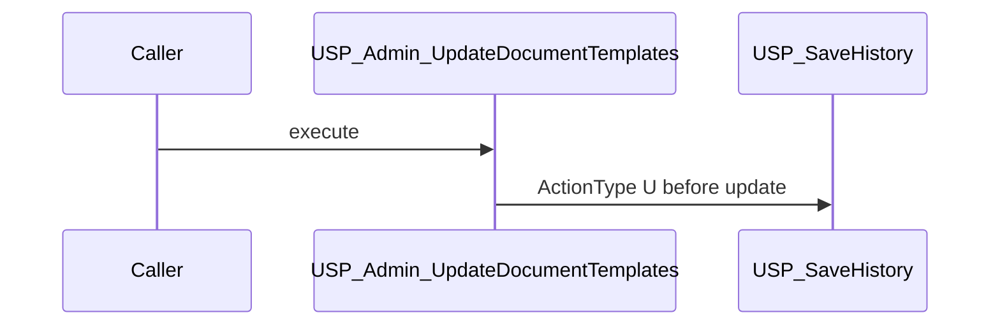
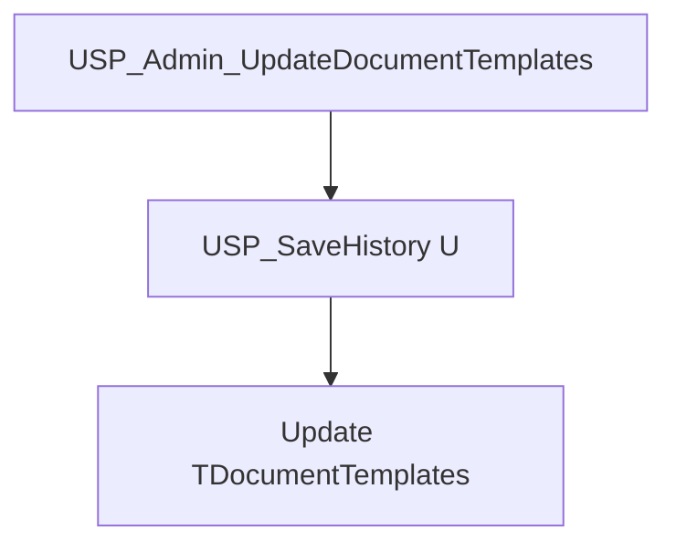

# USP_Admin_UpdateDocumentTemplates

## What it does

Snapshots the current `TDocumentTemplates` row into history with action `U`, then updates name, description, paths, fields, ESS options, email metadata, access ids, header/footer ESS flag, and date format for the given `DocumentId`.

## Parameters

| Name | Direction | What it is for |
|---|---|---|
| `@DocumentId` | in | Template to update |
| `@DocumentName` | in | Name |
| `@DocumentDescription` | in | Description |
| `@Templatemodule` | in | Logical module label |
| `@DocumentPath` | in | HTML folder path |
| `@DocumentFields` | in | Placeholder field ids |
| `@Updatedby` | in | Updating employee |
| `@Employerid` | in | Employer (passed; not used in the `WHERE`) |
| `@IsActive` | in | Active flag |
| `@ModuleId` | in | Module id |
| `@EmployeeAcceptance` | in | ESS acceptance |
| `@EnableAcceptanceTimeline` | in | Timeline enabled |
| `@NoofDays` | in | Timeline days |
| `@Timeline` | in | Timeline unit |
| `@ReminderFrequency` | in | Reminder frequency |
| `@CategoryId` | in | Category ids |
| `@EnableAcknowledgement` | in | Acknowledgement bit |
| `@DocEmailCC` | in | Optional CC |
| `@DocEmailSubject` | in | Optional subject |
| `@DocEmailSubFieldIds` | in | Optional subject fields |
| `@EmailDocumentPath` | in | Optional email HTML path |
| `@EmailDocumentFieldIds` | in | Optional email fields |
| `@RoleIds` | in | Optional role access |
| `@EmployeeIds` | in | Optional employee access |
| `@UseDefaultHeaderFooterForESS` | in | ESS header/footer default |
| `@DateFormatId` | in | Date format |

## Call sequence

## Callers

No other procedure or function calls this object. `DocBuilderDAL.UpdateAdminDocTemplates` executes it from Doc Builder after rewriting HTML files.

## Nested

| Object | Kind | When | Page |
|---|---|---|---|
| `USP_SaveHistory` | procedure | before the update | No page yet (source not in HRMS STOREPROCEDURE inventory) |

## Steps

1. Call `USP_SaveHistory` for `TDocumentTemplates` / `TDocumentTemplates_History` with action `U`.
2. Update `TDocumentTemplates` for `@DocumentId` with the supplied columns and `Updatedate` / `Updateby`.

## Tables

| Table | Read or write |
|---|---|
| `dbo.TDocumentTemplates` | write |
| `dbo.TDocumentTemplates_History` | write via `USP_SaveHistory` |

## Unresolved calls

`USP_SaveHistory` create script was not found under `HRMS-DATABASE/HRMS/STOREPROCEDURE/`.

## Flow

