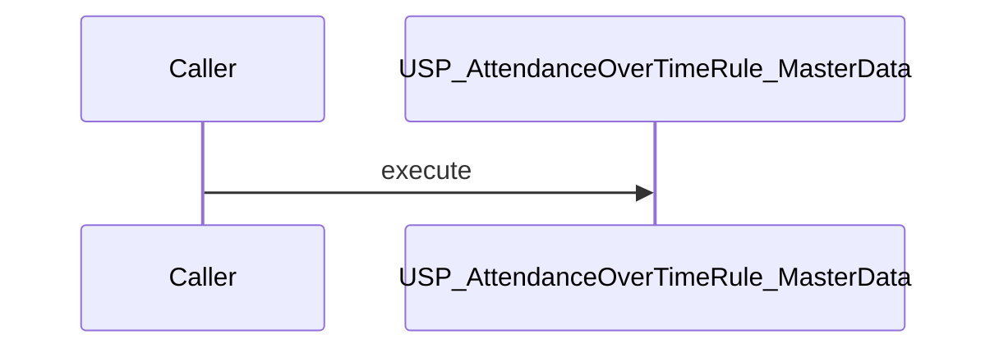
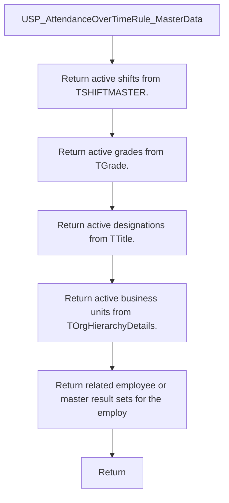

# USP_AttendanceOverTimeRule_MasterData

## What it does

Returns Core HRMS master lists (shifts, grades, designations, business units) used by TimePort Configuration pickers. Called from TimePort DAL on the Core connection.

## Parameters

| Name | Direction | What it is for |
|---|---|---|
| `@EmployerID` | in | Employer id |

## Call sequence

## Callers

Application. timeportDAL.GetMasterDataForConfig on the Core connection. Also used by attendance overtime setup screens.

## Nested

This object does not execute another procedure or user-defined function.

## Steps

In `HRMS-DATABASE/HRMS/STOREPROCEDURE/USP_AttendanceOverTimeRule_MasterData.sql`:

1. Return active shifts from TSHIFTMASTER.
2. Return active grades from TGrade.
3. Return active designations from TTitle.
4. Return active business units from TOrgHierarchyDetails.
5. Return related employee or master result sets for the employer.

## Tables

| Table | Read or write |
|---|---|
| `TSHIFTMASTER` | read |
| `TGrade` | read |
| `TTitle` | read |
| `TOrgHierarchyDetails` | read |

## Unresolved calls

None recorded for this page.

## Flow

