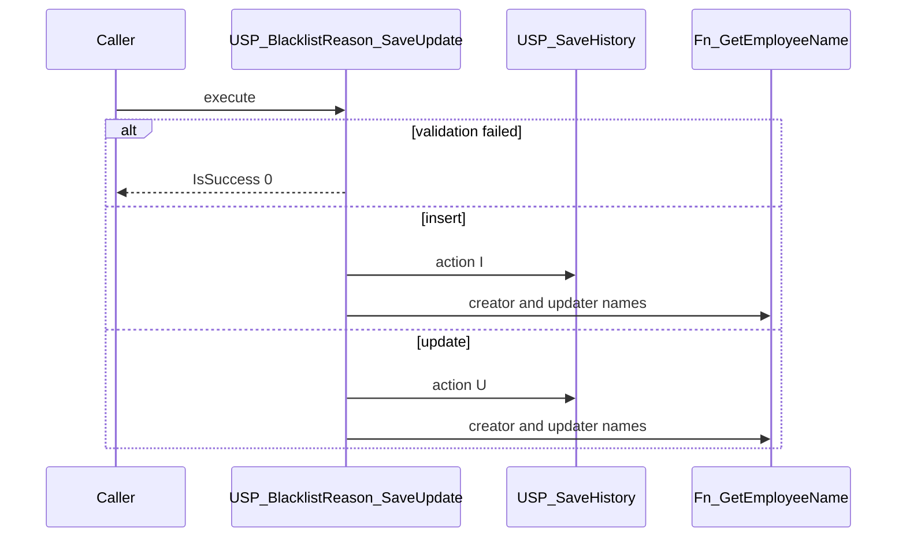
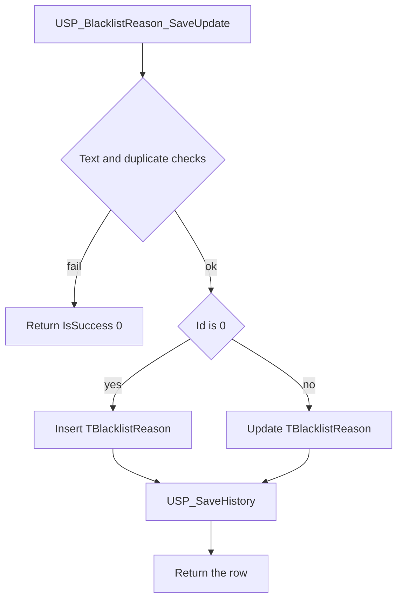

# USP_BlacklistReason_SaveUpdate

## What it does

Adds or updates one blacklist reason for an employer. A new reason is stored active. An update can change the text and the active flag. Empty text, text longer than 100 characters, a missing row, and a duplicate name for the same employer return `IsSuccess` 0 and a message. A successful save returns the row with the creator and updater names.

## Parameters

| Name | Direction | What it is for |
|---|---|---|
| `@BlacklistReasonID` | in | 0 inserts. A positive id updates that row. Default 0 |
| `@BlacklistReason` | in | Reason text. Trimmed. Must be 1 to 100 characters. The parameter is `nvarchar(4000)` so the length check can run |
| `@IsActive` | in | Used on update. Ignored on insert, which always stores 1. Default 1 |
| `@EmployerID` | in | Organisation |
| `@UserID` | in | Employee who added or updated the reason |

## Call sequence

## Callers

No other procedure or function calls this object.

## Nested

| Object | Kind | When | Page |
|---|---|---|---|
| `USP_SaveHistory` | procedure | after a successful insert or update | No page yet |
| `Fn_GetEmployeeName` | function | on the result row when the save succeeded | [Fn_GetEmployeeName](/docs/database/hrms/Fn_GetEmployeeName) |

`USP_SaveHistory` is executed by name. Its script is not in `HRMS-DATABASE`.

## Steps

1. Trim the reason. Treat a null id as 0 and a null active flag as 1.

2. Set a message when the reason is empty, longer than 100 characters, the id is not a live row for this employer (`IsDelete` 0), or another live row for this employer already has the same text.

3. When there is no message, start a transaction if the caller did not, or a savepoint `BR_Save` if it did. Insert when the id is 0 (`IsActive` 1) or update the text, active flag, and audit columns. Execute `USP_SaveHistory` for `TBlacklistReason` / `TBlacklistReason_History` with action `I` or `U`. Commit when this procedure opened the transaction.

4. On unique-index errors 2601 or 2627, return the duplicate message. Any other error is rethrown. A failed update that changes no row rolls back and returns `Blacklist Reason not found.`

5. Select `IsSuccess`, `Message`, the id, and, when the save succeeded, the reason row with `Fn_GetEmployeeName` for created-by and updated-by.

## Tables

| Table | Read or write |
|---|---|
| `TBlacklistReason` | read and write |

## Flow

