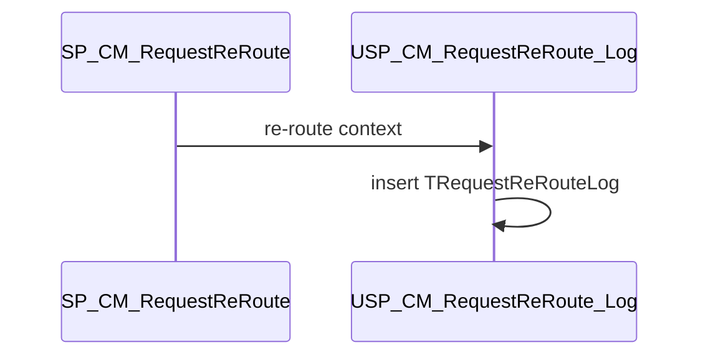
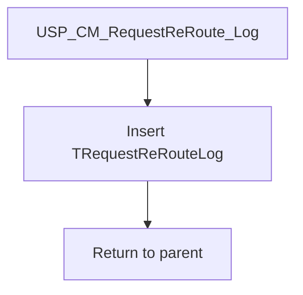

# USP_CM_RequestReRoute_Log

## What it does

Writes one `TRequestReRouteLog` row (and related from/to manager detail inserts in the same script) after a successful reassignment in `SP_CM_RequestReRoute`.

## Parameters

| Name | Direction | What it is for |
|---|---|---|
| `@RequestTransId` | in | Request id |
| `@FromManagerIDs` | in | Previous managers |
| `@ReRouteEmployeeid` | in | New manager |
| `@RequestType` | in | Request type |
| `@EmployerId` | in | Employer |
| `@Reason` | in | Reason |
| `@UpdatedBy` | in | Actor |
| `@LV_ApprovalLevel` | in | Routing level |

## Call sequence

## Callers

| Object | Kind | Page |
|---|---|---|
| `SP_CM_RequestReRoute` | procedure | [SP_CM_RequestReRoute](/docs/database/hrms/SP_CM_RequestReRoute) |

## Nested

No further procedure EXECs.

## Steps

1. Insert header into `TRequestReRouteLog`.
2. Persist from/to manager detail rows as defined in the script.

## Tables

| Table | Read or write |
|---|---|
| `TRequestReRouteLog` | write |

## Unresolved calls

None.

## Flow

