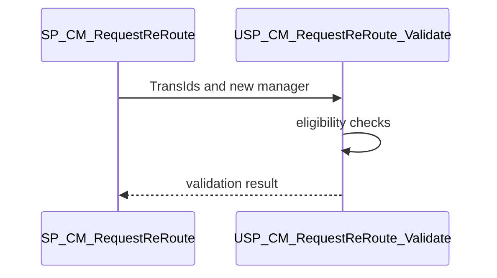
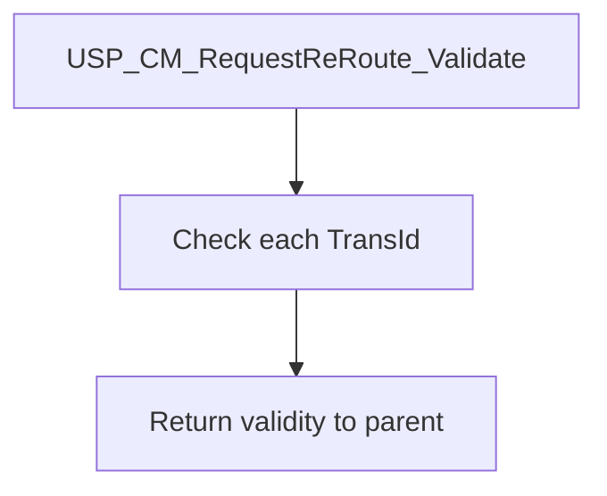

# USP_CM_RequestReRoute_Validate

## What it does

Validates that pending request trans ids can be reassigned to `@ReRouteEmployeeid` for the given `@RequestType` before `SP_CM_RequestReRoute` updates managers.

## Parameters

| Name | Direction | What it is for |
|---|---|---|
| `@TransIds` | in | Request trans id list |
| `@ReRouteEmployeeid` | in | Target manager |
| `@RequestType` | in | Workflow request type |

## Call sequence

## Callers

| Object | Kind | Page |
|---|---|---|
| `SP_CM_RequestReRoute` | procedure | [SP_CM_RequestReRoute](/docs/database/hrms/SP_CM_RequestReRoute) |

## Nested

No further procedure EXECs required for this one-level page.

## Steps

1. Parse `@TransIds`.
2. Ensure each pending row may be handed to `@ReRouteEmployeeid` for `@RequestType`.

## Tables

| Table | Read or write |
|---|---|
| `TRequestWorkflows` | read |
| Employee / eligibility tables | read |

## Unresolved calls

None.

## Flow

