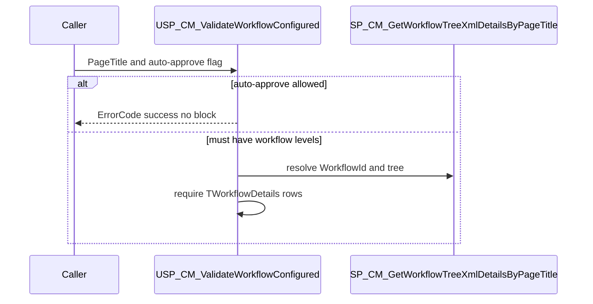
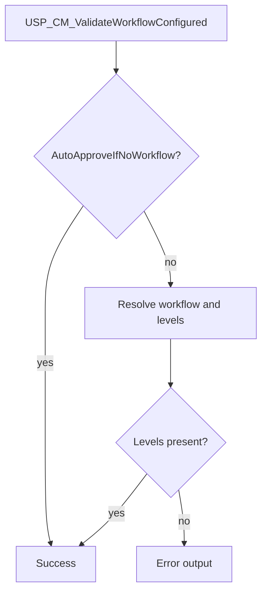

# USP_CM_ValidateWorkflowConfigured

## What it does

Shared workflow-configuration guard for Leave / AR / WFH / OH validate-insert paths. Resolves a workflow for `@PageTitle` and requires at least one `TWorkflowDetails` level when auto-approve-if-no-workflow is off — preventing a header-only workflow from silently auto-approving.

## Parameters

| Name | Direction | What it is for |
|---|---|---|
| `@PageTitle` | in | e.g. `LEAVEREQUEST` |
| `@Employerid` / `@Employeeid` | in | Scope |
| `@IsAutoApproveIfNoWorkflow` | in | Customer flag; when 1 this SP is effectively a no-op success |
| `@WorkflowId` | out | Resolved workflow id |
| `@ErrorCode` / `@ErrorMessage` | out | Gate result |

## Call sequence

## Callers

Called from leave / AR validate-insert procedures including `USP_LA_ValidateLeaveRequest` and `SP_LA_AddAttendanceRegularisationDetails`.

## Nested

| Object | Kind | Page |
|---|---|---|
| `SP_CM_GetWorkflowTreeXmlDetailsByPageTitle` | procedure | [SP_CM_GetWorkflowTreeXmlDetailsByPageTitle](/docs/database/hrms/SP_CM_GetWorkflowTreeXmlDetailsByPageTitle) |

## Steps

1. If `@IsAutoApproveIfNoWorkflow = 1`, return success without blocking.
2. Otherwise resolve workflow via page title; ensure levels exist in `TWorkflowDetails`.
3. Output `@WorkflowId` and error code/message.

## Tables

| Table | Read or write |
|---|---|
| `TWorkflowManagement` / `TWorkflowDetails` | read |

## Unresolved calls

None.

## Flow

