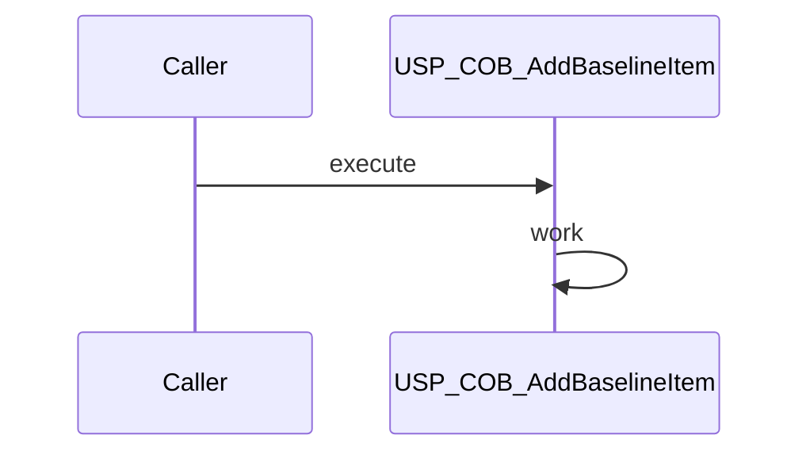
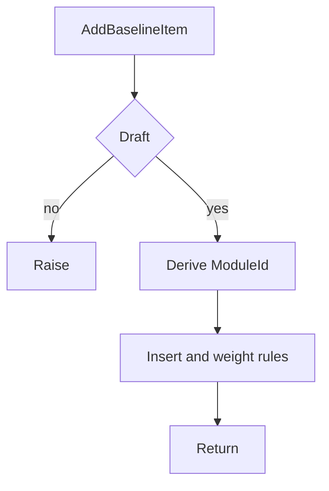

# USP_COB_AddBaselineItem

## What it does

Adds one Module, Section, Activity, or Task to a Draft baseline. Derives ModuleId from the ancestor Module below Module level. Applies module-wide Task weight caps and sibling rescale rules when adding Tasks.

## Parameters

| Name | Direction | What it is for |
|---|---|---|
| `@BaselineTemplateId` | in | Draft template |
| `@ParentItemId` | in | Null for Module |
| `@Level` | in | Module Section Activity Task |
| `@ModuleId` | in | Honoured for Module only |
| `@Name` | in | Display name |
| `@HrmsNavPath` | in | Optional path |
| `@SectionName` | in | Legacy Activity banner |
| `@Weightage` | in | Task weight or null |
| `@DefaultEffortHrs` | in | Optional |
| `@DefaultDurationDays` | in | Optional 1-90 |
| `@IsMandatory` | in | Bit |
| `@IsAutoTracked` | in | Bit |
| `@TemplateId` | in | COB upload template when auto-tracked |
| `@CreatedBy` | in | Actor |

## Call sequence

Calls no other procedures or functions.

## Callers

Procedures and functions that call this object.

No other procedure or function calls this object. App callers are listed in the Plan Templates guide.

## Nested

| Object | Kind | When | Page |
|---|---|---|---|
| *(none)* | — | — | — |

## Steps

1. Refuse unless template Status is Draft.

2. Validate level/parent rules; derive ModuleId for non-Module rows.

3. Insert the item; for Tasks apply weight allocation and module cap rescale as documented in the proc header.

4. Return the new BaselineItemId and RowVersion.

## Tables

| Table | Read or write |
|---|---|
| `dbo.TCOB_PlanBaselineTemplate` | read |
| `dbo.TCOB_PlanBaselineItem` | read and write |

## Unresolved calls

None.

## Flow

