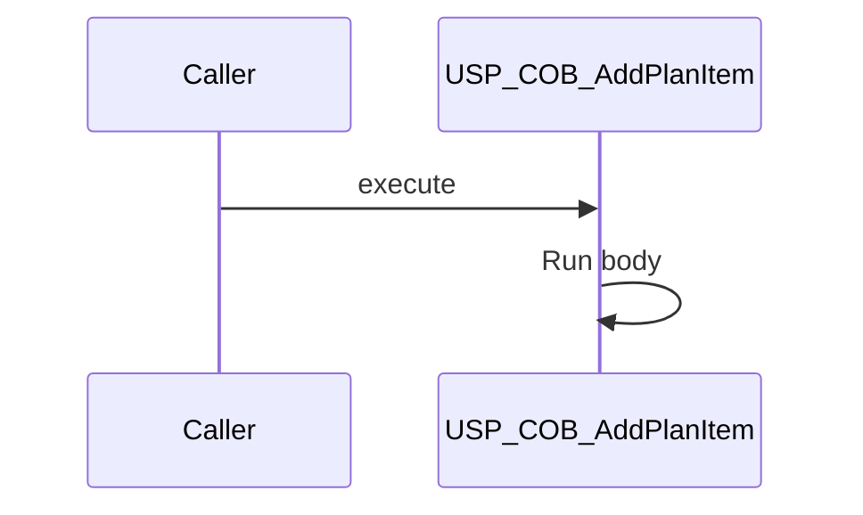
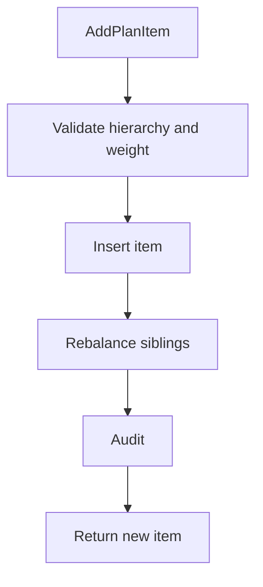

# USP_COB_AddPlanItem

## What it does

Adds a custom plan item (Module/Section/Activity/Task). NULL weight on a Task equal-splits the Activity total across siblings; an explicit weight rebalances siblings and may raise COB_WEIGHT_OVER_100. Supports insert-after positioning and optional actual dates / IsNA.

## Parameters

| Name | Direction | What it is for |
|---|---|---|
| `@CustomerPlanId` | in | Plan |
| `@ParentPlanItemId` | in | Parent item |
| `@Level` | in | Module, Section, Activity, or Task |
| `@ModuleId` | in | Module id when applicable |
| `@Name` | in | Display name |
| `@Weightage` | in | Weight; NULL equal-splits tasks |
| `@PlannedStart` / `@PlannedEnd` | in | Planned dates |
| `@PlannedEffortHrs` | in | Effort hours |
| `@CreatedBy` | in | Actor |
| `@InsertAfterPlanItemId` | in | Sibling insert position |
| `@ActualStart` / `@ActualEnd` | in | Optional actuals |
| `@IsNA` | in | Not-applicable flag |

## Call sequence

Calls no other procedures or functions.

## Callers

Procedures and functions that call this object.

No other procedure or function calls this object. Application caller: Core Node `PlannerAuditDAL.addPlanItem` via `POST /api/clientonboard2/plan/item/add`.

## Nested

Calls no other procedures or functions.

## Steps

1. Validate plan, parent level rules, and weight budget.

2. Insert the new item with SortOrder placement.

3. Rebalance sibling task weights when needed.

4. Write change-log audit and return the new item.

## Tables

| Table | Read or write |
|---|---|
| `TCOB_CustomerPlan` | read |
| `TCOB_CustomerPlanItem` | read and write |
| `TCOB_AuditTrail` | write |

## Unresolved calls

None.

## Flow

