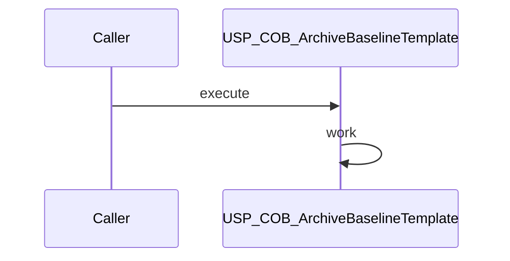
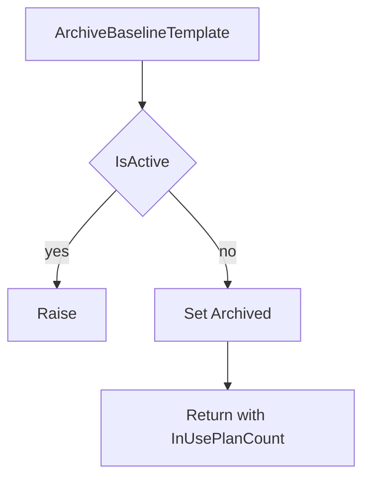

# USP_COB_ArchiveBaselineTemplate

## What it does

Sets Status=Archived on a non-active Draft or Published version. Refuses the currently active baseline so instantiation cannot silently create empty plans.

## Parameters

| Name | Direction | What it is for |
|---|---|---|
| `@BaselineTemplateId` | in | Version to archive |
| `@RowVersion` | in | Optional concurrency |
| `@UpdatedBy` | in | Actor |

## Call sequence

Calls no other procedures or functions.

## Callers

Procedures and functions that call this object.

No other procedure or function calls this object. App callers are listed in the Plan Templates guide.

## Nested

| Object | Kind | When | Page |
|---|---|---|---|
| *(none)* | — | — | — |

## Steps

1. Idempotent success when already Archived.

2. Raise COB_TEMPLATE_ACTIVE when IsActive=1.

3. Update Status to Archived; return InUsePlanCount for awareness (not a block).

## Tables

| Table | Read or write |
|---|---|
| `dbo.TCOB_PlanBaselineTemplate` | read and write |
| `dbo.TCOB_CustomerPlan` | read |

## Unresolved calls

None.

## Flow

