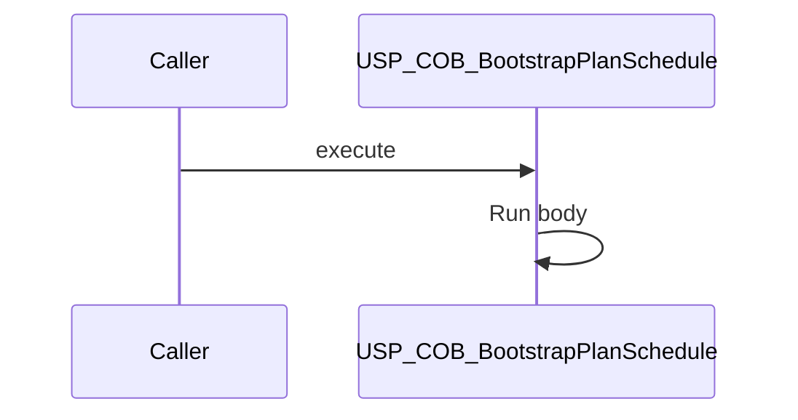
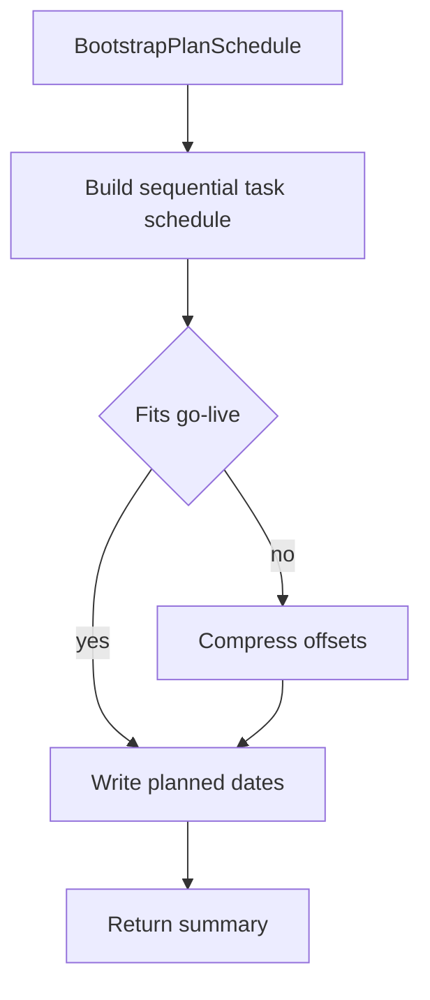

# USP_COB_BootstrapPlanSchedule

## What it does

Seeds planned start/end dates on a customer plan from project start (and optional go-live). Modules/activities start in parallel; tasks run sequentially within an activity using baseline DefaultDurationDays. Can compress into the go-live window. `@Overwrite` controls whether existing planned dates are replaced.

## Parameters

| Name | Direction | What it is for |
|---|---|---|
| `@CustomerPlanId` | in | Plan to schedule |
| `@ProjectStartDate` | in | Anchor start |
| `@GoLiveDate` | in | Optional go-live; compresses when needed |
| `@Overwrite` | in | 0 fill blanks only; 1 re-plan all |
| `@UpdatedBy` | in | Actor |

## Call sequence

Calls no other procedures or functions.

## Callers

Procedures and functions that call this object.

No other procedure or function calls this object. Application caller: Core Node `PlannerAuditDAL.bootstrapPlanSchedule` via `POST /api/clientonboard2/plan/schedule/bootstrap`.

## Nested

Calls no other procedures or functions.

## Steps

1. Validate plan and anchors.

2. Propose task durations from baseline defaults; derive activity/module spans.

3. Compress into go-live window when the projected end would overrun.

4. Write planned dates per overwrite rules and return schedule summary metrics.

## Tables

| Table | Read or write |
|---|---|
| `TCOB_CustomerPlan` | read |
| `TCOB_CustomerPlanItem` | read and write |
| `TCOB_PlanBaselineItem` | read |

## Unresolved calls

None.

## Flow

