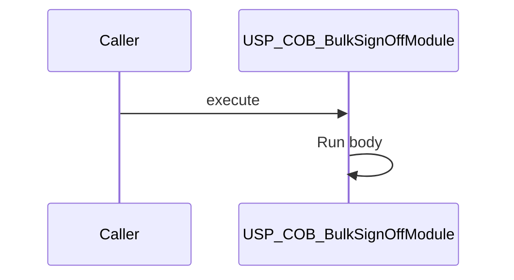
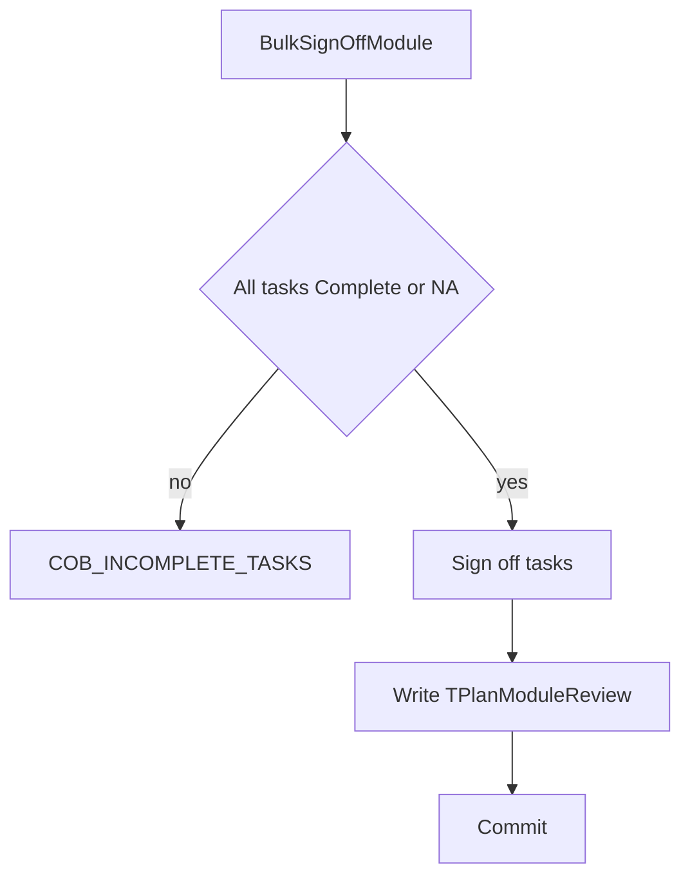

# USP_COB_BulkSignOffModule

## What it does

Bulk-signs off every non-removed Task in a module when all are Complete or N/A. Writes task ReviewStatus, a TPlanModuleReview row, and audit entries in one transaction. Raises COB_INCOMPLETE_TASKS when open tasks remain.

## Parameters

| Name | Direction | What it is for |
|---|---|---|
| `@CustomerPlanId` | in | Plan |
| `@ModuleId` | in | Module to review |
| `@Remark` | in | Shared reviewer remark |
| `@ReviewedBy` | in | Reviewer |

## Call sequence

Calls no other procedures or functions.

## Callers

Procedures and functions that call this object.

No other procedure or function calls this object. Application caller: Core Node `PlannerAuditDAL.bulkSignOffModule` via `POST /api/clientonboard2/plan/module/bulk-signoff`.

## Nested

Calls no other procedures or functions.

## Steps

1. Count incomplete non-N/A tasks; raise COB_INCOMPLETE_TASKS when any remain.

2. Update all module tasks to SignedOff.

3. Upsert TPlanModuleReview and write audit rows; return reviewed count.

## Tables

| Table | Read or write |
|---|---|
| `TCOB_CustomerPlanItem` | read and write |
| `TCOB_CustomerPlan` | read |
| `TPlanModuleReview` | read and write |
| `TCOB_AuditTrail` | write |

## Unresolved calls

None.

## Flow

