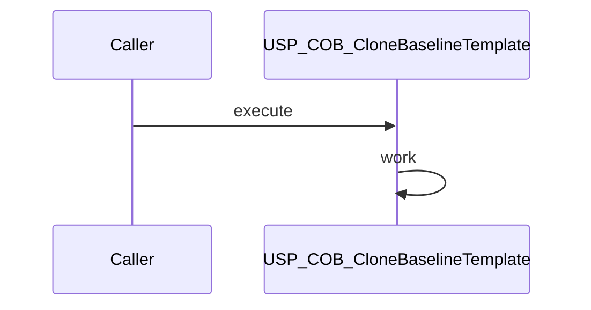
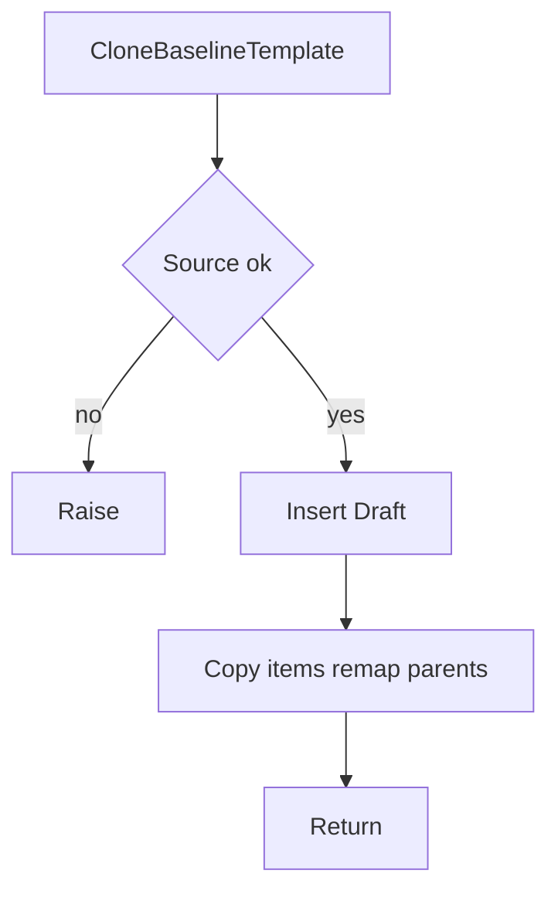

# USP_COB_CloneBaselineTemplate

## What it does

Creates a new Draft by copying every non-removed item from a source version and remapping ParentItemId via MERGE OUTPUT. Soft-deleted rows are not copied.

## Parameters

| Name | Direction | What it is for |
|---|---|---|
| `@SourceBaselineTemplateId` | in | Source version |
| `@Name` | in | Optional new name |
| `@Description` | in | Optional |
| `@CreatedBy` | in | Actor |

## Call sequence

Calls no other procedures or functions.

## Callers

Procedures and functions that call this object.

No other procedure or function calls this object. App callers are listed in the Plan Templates guide.

## Nested

| Object | Kind | When | Page |
|---|---|---|---|
| *(none)* | — | — | — |

## Steps

1. Load source; raise COB_NOT_FOUND when missing.

2. Insert new Draft header with next Version.

3. MERGE-copy live items capturing source to new ids; rewrite ParentItemId from the map.

4. Return new BaselineTemplateId, Version, CopiedCount.

## Tables

| Table | Read or write |
|---|---|
| `dbo.TCOB_PlanBaselineTemplate` | read and write |
| `dbo.TCOB_PlanBaselineItem` | read and write |

## Unresolved calls

None.

## Flow

