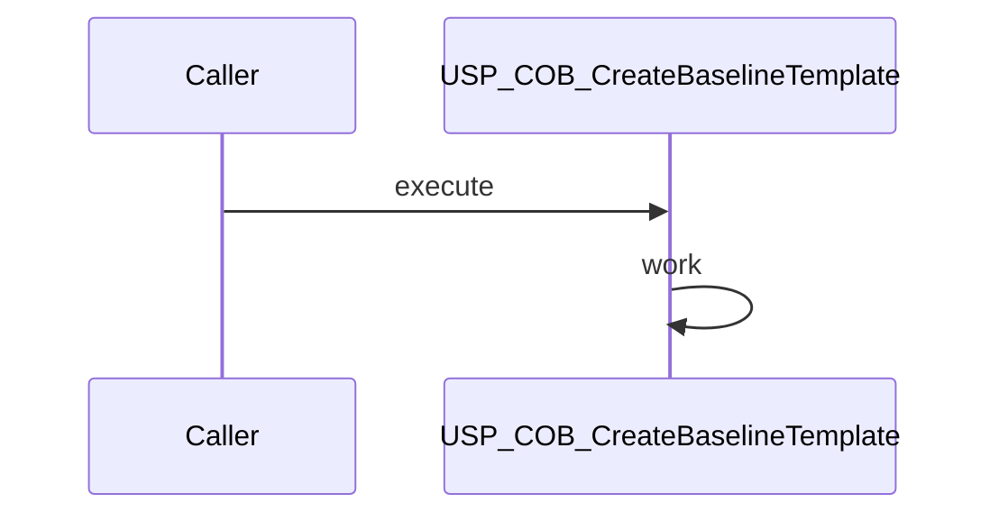
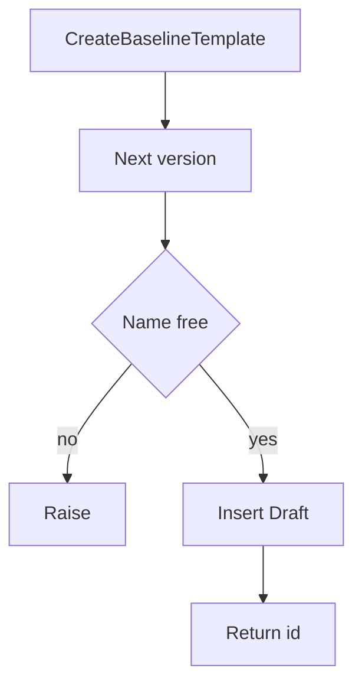

# USP_COB_CreateBaselineTemplate

## What it does

Creates an empty Draft baseline with Version = MAX+1 across all templates. Never sets IsActive; publish is required before instantiation uses it.

## Parameters

| Name | Direction | What it is for |
|---|---|---|
| `@Name` | in | Required display name |
| `@Description` | in | Optional |
| `@CreatedBy` | in | Actor employee id |

## Call sequence

Calls no other procedures or functions.

## Callers

Procedures and functions that call this object.

No other procedure or function calls this object. App callers are listed in the Plan Templates guide.

## Nested

| Object | Kind | When | Page |
|---|---|---|---|
| *(none)* | — | — | — |

## Steps

1. Require non-blank name.

2. Under UPDLOCK/HOLDLOCK take next Version and refuse duplicate Name.

3. Insert Draft IsActive=0; return BaselineTemplateId, Version, Status.

## Tables

| Table | Read or write |
|---|---|
| `dbo.TCOB_PlanBaselineTemplate` | read and write |

## Unresolved calls

None.

## Flow

