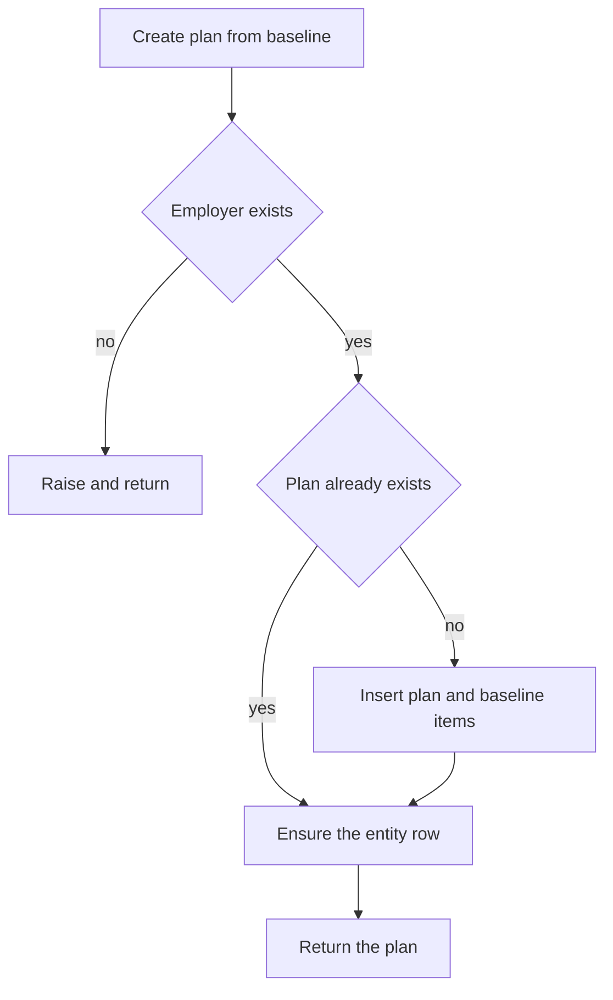

# USP_COB_CreateCustomerPlanFromBaseline

## What it does

Creates one client-onboarding plan for one organisation from the latest published active baseline. If that employer already has a plan, the insert is skipped and a missing entity row is repaired. The procedure returns the plan id, employer, root, and Parent or Child role.

## Parameters

| Name | Direction | What it is for |
|---|---|---|
| `@EmployerId` | in | Organisation that owns the plan |
| `@LicensedModuleIdsCsv` | in | Licensed module ids. Null includes only baseline items whose module id is null |
| `@LicenseSnapshotJson` | in | Snapshot stored on the plan |
| `@CreatedBy` | in | Creating user |

## Call sequence

Calls no other procedures or functions.

## Callers

Procedures and functions that call this object.

| Object | Kind | Page |
|---|---|---|
| `USP_COB_InstantiatePlanForEmployer` | procedure | [USP_COB_InstantiatePlanForEmployer](/docs/database/hrms/USP_COB_InstantiatePlanForEmployer) |

## Nested

Calls no other procedures or functions.

## Steps

1. Read ParentEmployerid and root from TEmployerDetails. Raise COB_NOT_FOUND and return when the employer is missing.

2. Set EntityRole to Parent when the parent id is null or 0, otherwise Child.

3. Take the highest Version from TCOB_PlanBaselineTemplate where IsActive is 1 and Status is Published.

4. When TCOB_CustomerPlan has no row for this employer, insert an Active plan and MERGE baseline items that are not removed and whose module is null or in the licensed list. Then set ParentPlanItemId from the baseline parent map.

5. Insert TCOB_CustomerPlanEntity for this employer when that row is missing.

6. Commit and return CustomerPlanId, EmployerId, RootEmployerId, and EntityRole.

## Tables

| Table | Read or write |
|---|---|
| `TEmployerDetails` | read |
| `TCOB_PlanBaselineTemplate` | read |
| `TCOB_CustomerPlan` | read and write |
| `TCOB_PlanBaselineItem` | read |
| `TCOB_CustomerPlanItem` | write |
| `TCOB_CustomerPlanEntity` | read and write |

## Flow

