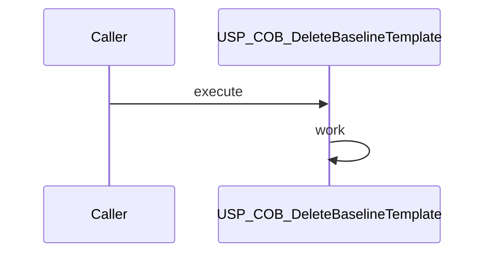
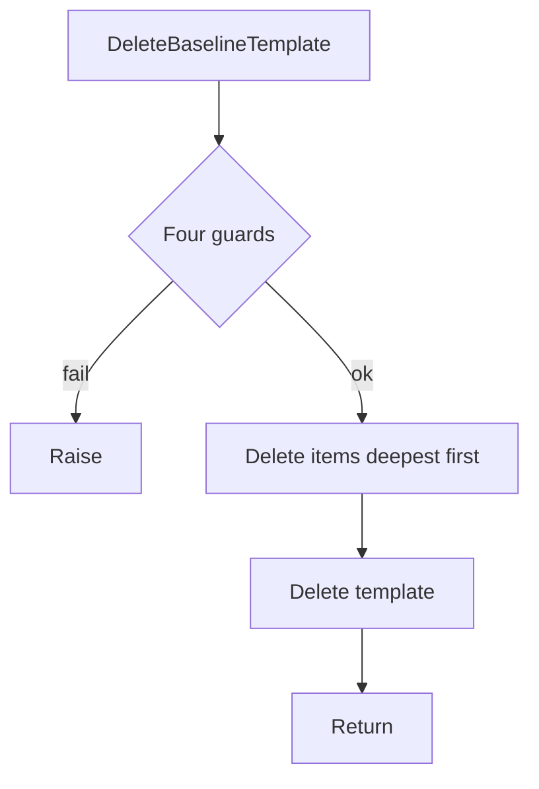

# USP_COB_DeleteBaselineTemplate

## What it does

Permanently deletes a Draft version and its items. Four guards: Draft only, not active, no customer plans, no plan items referencing its baseline items. Published history must Archive instead.

## Parameters

| Name | Direction | What it is for |
|---|---|---|
| `@BaselineTemplateId` | in | Draft to delete |
| `@RowVersion` | in | Optional concurrency |
| `@DeletedBy` | in | Actor |

## Call sequence

Calls no other procedures or functions.

## Callers

Procedures and functions that call this object.

No other procedure or function calls this object. App callers are listed in the Plan Templates guide.

## Nested

| Object | Kind | When | Page |
|---|---|---|---|
| *(none)* | — | — | — |

## Steps

1. Enforce Draft, IsActive=0, no TCOB_CustomerPlan / TCOB_CustomerPlanItem provenance links.

2. Delete items deepest-first (Task then Activity then Section then Module), then delete the template header.

3. Return deleted counts.

## Tables

| Table | Read or write |
|---|---|
| `dbo.TCOB_PlanBaselineTemplate` | read and write |
| `dbo.TCOB_PlanBaselineItem` | read and write |
| `dbo.TCOB_CustomerPlan` | read |
| `dbo.TCOB_CustomerPlanItem` | read |

## Unresolved calls

None.

## Flow

