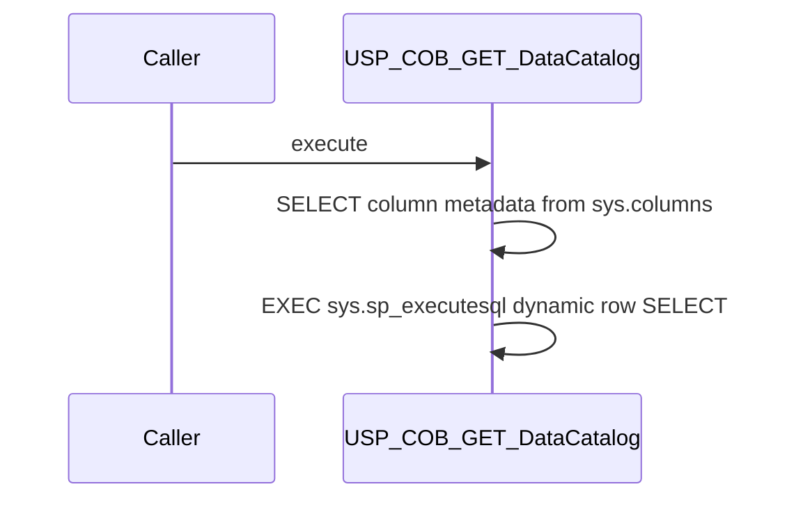
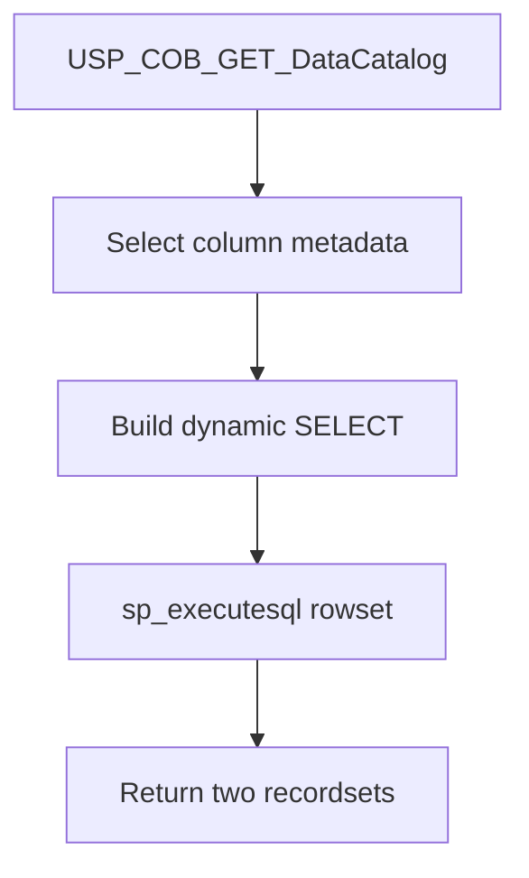

# USP_COB_GET_DataCatalog

## What it does

Returns Data Catalog grid payloads for Client Onboarding: first a column-metadata recordset from `sys.columns` / `sys.types` on `dbo.TDataCatalog` (including `isSystem` for read-only UI columns), then every catalog row via dynamic SQL built from the same column list so new table columns appear without a code change. Date/datetime columns are converted to ISO-style varchar (style 126) without a time-zone suffix.

## Parameters

None.

## Call sequence

Calls no other procedures or functions (only `sys.sp_executesql`).

## Callers

Procedures and functions that call this object.

No other procedure or function calls this object. App caller: `ClientOnboardingDAL.getDataCatalog` → `GET /api/clientonboard2/data-catalog`.

## Nested

| Object | Kind | When | Page |
|---|---|---|---|
| *(none)* | — | — | — |

## Steps

1. `SET NOCOUNT ON`.

2. Select column metadata for `dbo.TDataCatalog` ordered by `column_id`: `name`, `sqlType`, character `maxLength` (−1 = MAX), `isNullable`, `isIdentity`, `isComputed`, `isSystem` (CatalogId / CreateDate / UpdatedDate, identity, computed, or user-defined type), `ordinal`.

3. Build `@Sql` with `STRING_AGG` of quoted column expressions; wrap date/datetime types in `CONVERT(..., 126)`.

4. `EXEC sys.sp_executesql @Sql` to return every `TDataCatalog` row ordered by `CatalogId`.

## Tables

| Table | Read or write |
|---|---|
| `dbo.TDataCatalog` | read (via dynamic SQL) |
| `sys.columns` | read |
| `sys.types` | read |

## Unresolved calls

| Call | Notes |
|---|---|
| `sys.sp_executesql` | Dynamic SELECT list built from `sys.columns`; exact column set depends on live table shape |

## Flow

