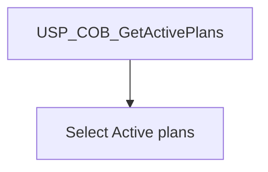

# USP_COB_GetActivePlans

## What it does

Returns every Active TCOB_CustomerPlan with its LicenseSnapshotJson for the unattended licence-change polling job.

## Parameters

| Name | Direction | What it is for |
|---|---|---|
| `*(none)*` | — | No parameters |

## Call sequence

Calls no other procedures or functions.

## Callers

No other procedure or function calls this object. `PlannerAuditDAL.getActivePlans` executes it from `checkLicenseChanges`.

## Nested

Calls no other procedures or functions.

## Steps

1. Select Active plans with EmployerId and LicenseSnapshotJson.

## Tables

| Table | Read or write |
|---|---|
| `dbo.TCOB_CustomerPlan` | read |

## Unresolved calls

None.

## Flow

