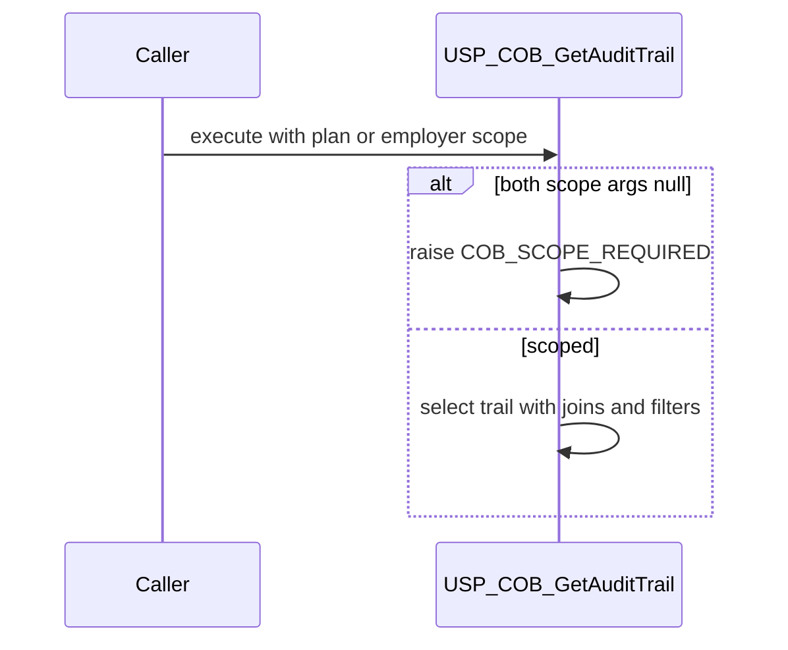
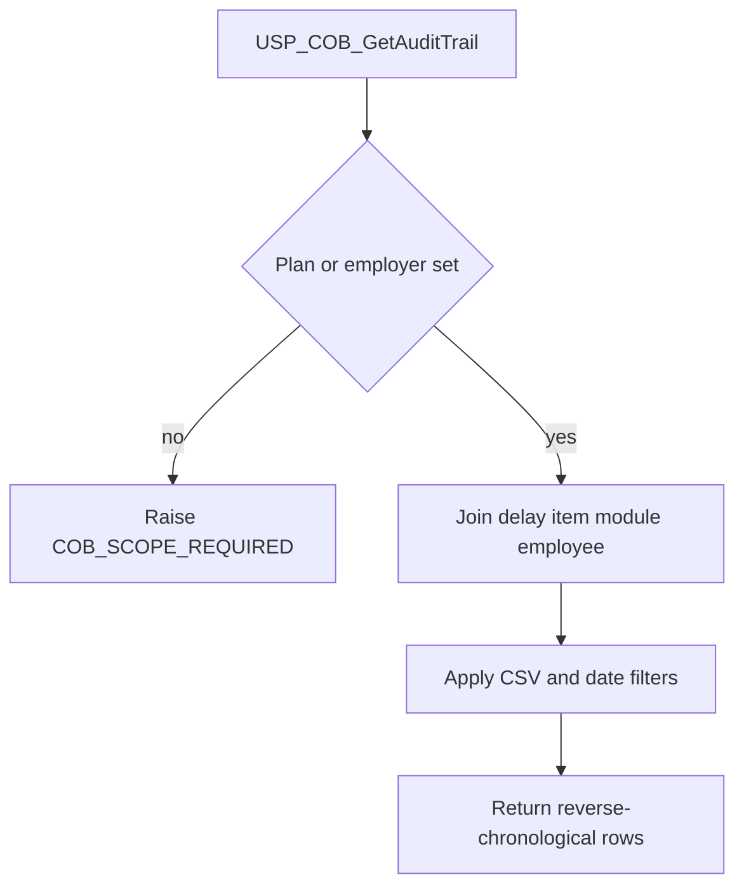

# USP_COB_GetAuditTrail

## What it does

Returns a filtered, reverse-chronological Client Onboarding audit feed from `TCOB_AuditTrail`. It requires a `CustomerPlanId` or `EmployerId` scope, joins plan item / delay / module / employee display fields, and rewrites `ModuleAdded` / `ModuleRemoved` remarks that still say `ModuleId n` into the live module name. BulkSignOff rows without a plan item fall back to the audit row’s own `ModuleId`.

## Parameters

| Name | Direction | What it is for |
|---|---|---|
| `@CustomerPlanId` | in | Scope to one plan. Null allowed when employer is set |
| `@EmployerId` | in | Scope to one employer. Null allowed when plan is set |
| `@ModuleIds` | in | Optional CSV of module ids (plan item or audit `ModuleId`) |
| `@EventSource` | in | Optional CSV of event sources |
| `@DelayCategoryIds` | in | Optional CSV of delay category ids |
| `@FromUtc` | in | Optional lower bound on `EventAtUtc` |
| `@ToUtc` | in | Optional upper bound on `EventAtUtc` |

## Call sequence

## Callers

No other procedure or function calls this object. `PlannerAuditDAL.getAuditTrail` executes it for `GET /api/clientonboard2/audit`.

## Nested

Calls no other procedures or functions.

## Steps

1. Raise `COB_SCOPE_REQUIRED` and return when both `@CustomerPlanId` and `@EmployerId` are null.

2. Select audit rows from `TCOB_AuditTrail` left-joined to `TCOB_DelayCategory`, `TCOB_CustomerPlanItem`, `THrmsModules` (row module and item module), and `TEmployee` for actor display (`Super User` when `ActorEmployeeId = -1`).

3. For `ModuleAdded` / `ModuleRemoved` remarks that match `ModuleId [0-9]%`, substitute the module name from `THrmsModules` into the remark text.

4. Apply optional CSV filters via `STRING_SPLIT` on module, event source, and delay category, plus optional UTC date bounds.

5. Order by `EventAtUtc` descending, then `AuditId` descending.

## Tables

| Table | Read or write |
|---|---|
| `dbo.TCOB_AuditTrail` | read |
| `dbo.TCOB_DelayCategory` | read |
| `dbo.TCOB_CustomerPlanItem` | read |
| `dbo.THrmsModules` | read |
| `dbo.TEmployee` | read |

## Unresolved calls

None.

## Flow

