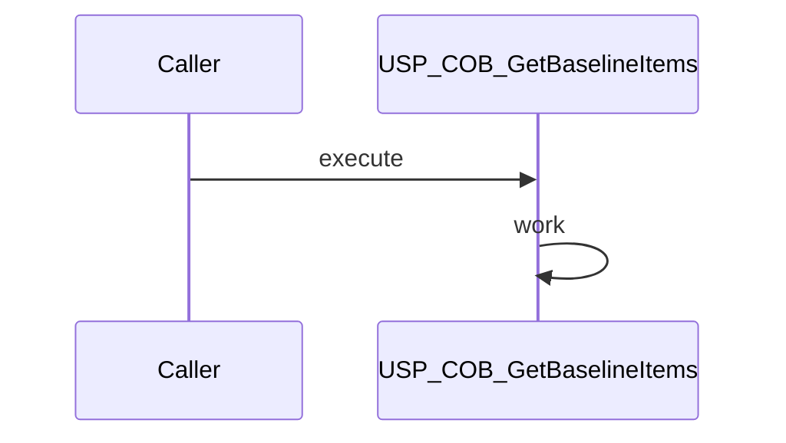
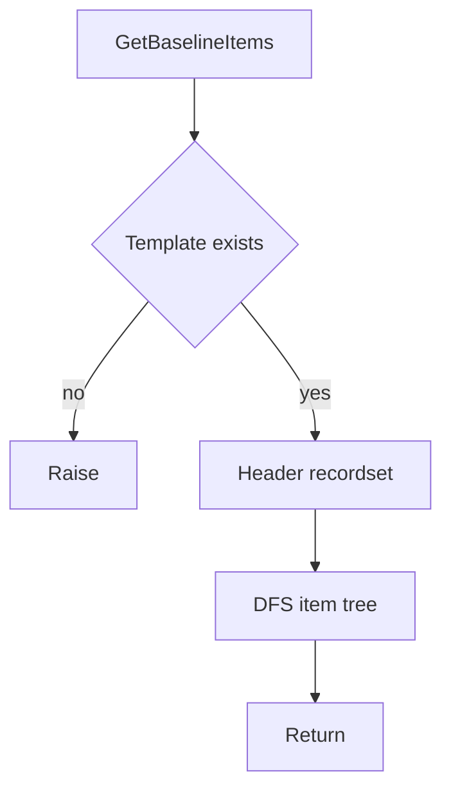

# USP_COB_GetBaselineItems

## What it does

Returns one baseline version as two recordsets: the template header, then a depth-first item tree with derived RollupWeightage. Used by the Plan Builder editor.

## Parameters

| Name | Direction | What it is for |
|---|---|---|
| `@BaselineTemplateId` | in | Template version to load |

## Call sequence

Calls no other procedures or functions.

## Callers

Procedures and functions that call this object.

No other procedure or function calls this object. App callers are listed in the Plan Templates guide.

## Nested

| Object | Kind | When | Page |
|---|---|---|---|
| *(none)* | — | — | — |

## Steps

1. Validate id; raise COB_NOT_FOUND when the template is missing.

2. Recordset 1: header columns including RowVersion and Status.

3. Recordset 2: recursive SortPath walk of non-removed items; join rollups attributed from Task weights to every ancestor.

## Tables

| Table | Read or write |
|---|---|
| `dbo.TCOB_PlanBaselineTemplate` | read |
| `dbo.TCOB_PlanBaselineItem` | read |

## Unresolved calls

None.

## Flow

