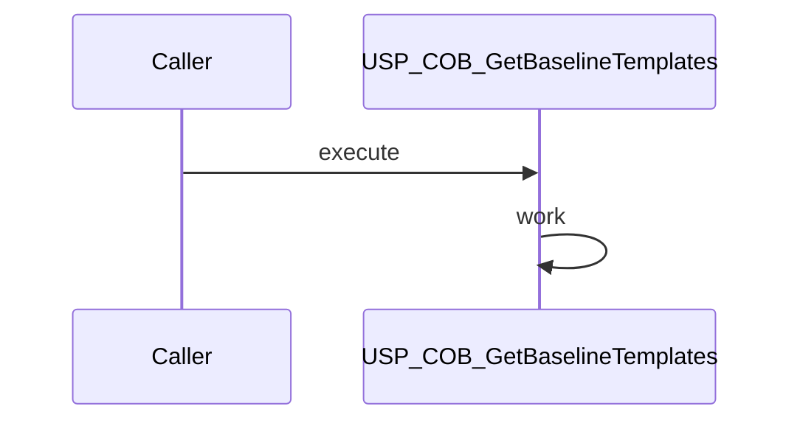
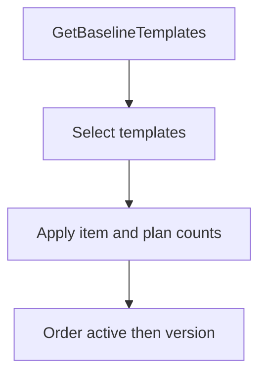

# USP_COB_GetBaselineTemplates

## What it does

Lists every baseline template version for the Plan Builder grid with module/activity/task counts (excluding IsRemoved) and InUsePlanCount from customer plans that snapshot that version.

## Parameters

| Name | Direction | What it is for |
|---|---|---|
| *(none)* | — | — |

## Call sequence

Calls no other procedures or functions.

## Callers

Procedures and functions that call this object.

No other procedure or function calls this object. App callers are listed in the Plan Templates guide.

## Nested

| Object | Kind | When | Page |
|---|---|---|---|
| *(none)* | — | — | — |

## Steps

1. Select all rows from TCOB_PlanBaselineTemplate.

2. Outer-apply live item counts by Level and count of TCOB_CustomerPlan rows for InUsePlanCount.

3. Order by IsActive descending, then Version descending.

## Tables

| Table | Read or write |
|---|---|
| `dbo.TCOB_PlanBaselineTemplate` | read |
| `dbo.TCOB_PlanBaselineItem` | read |
| `dbo.TCOB_CustomerPlan` | read |

## Unresolved calls

None.

## Flow

