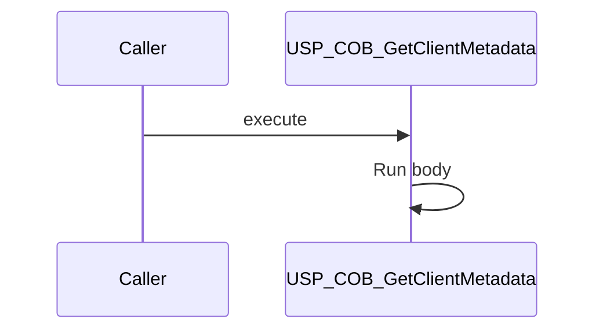
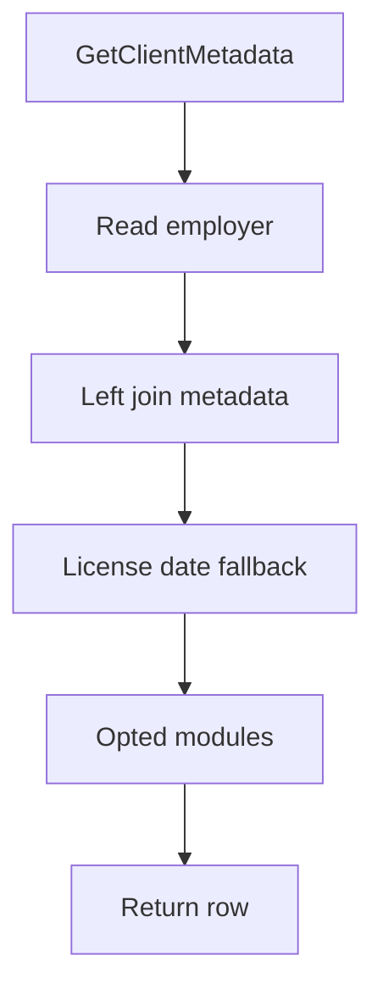

# USP_COB_GetClientMetadata

## What it does

Reads one organisation's implementation metadata. Starts from TEmployerDetails so OrganizationUrl / CompanyCode still return when no metadata row exists. ProjectStartDate / GoLiveDate fall back to the family Active license when manual values are absent. Includes parent/child org names and live opted module count/names.

## Parameters

| Name | Direction | What it is for |
|---|---|---|
| `@EmployerId` | in | Organisation |

## Call sequence

Calls no other procedures or functions.

## Callers

Procedures and functions that call this object.

No other procedure or function calls this object. Application caller: Core Node `PlannerAuditDAL.getClientMetadata` via `GET /api/clientonboard2/plan/metadata`.

## Nested

Calls no other procedures or functions.

## Steps

1. Read employer row and optional TCOB_ClientImplementationMetadata.

2. Fall back project/go-live dates from the family Active TLicence when manual dates are null.

3. Aggregate parent/child names and opted modules from TEmployerModule / THrmsModules.

## Tables

| Table | Read or write |
|---|---|
| `TEmployerDetails` | read |
| `TCOB_ClientImplementationMetadata` | read |
| `TLicence` | read |
| `TEmployerModule` | read |
| `THrmsModules` | read |

## Unresolved calls

None.

## Flow

