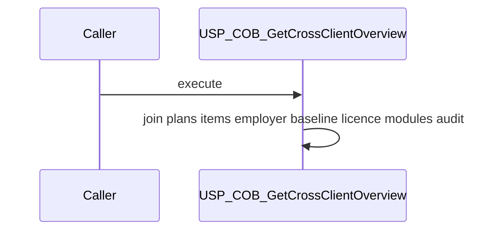
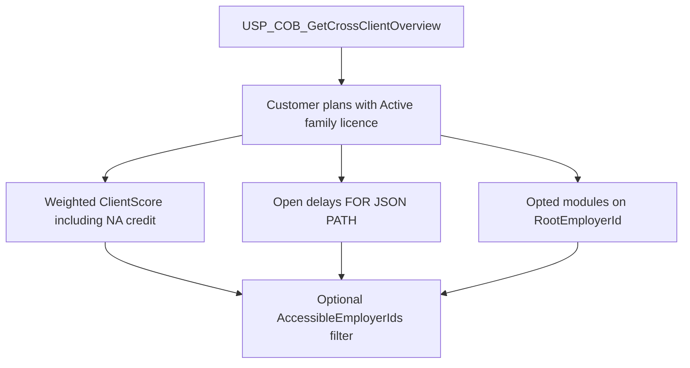

# USP_COB_GetCrossClientOverview

## What it does

Returns one rollup row per `TCOB_CustomerPlan` whose family root holds an Active, not soft-deleted `TLicence`. Each row includes organisation name and `custid`, plan status / planned start / baseline template name, a weight-based `ClientScore` (N/A tasks count as 100% complete), open-delay counts by active delay category as JSON, and opted-module count/names from the root employer’s current licence entitlement. Optional `@AccessibleEmployerIds` restricts rows to a comma-separated employer list; `NULL` returns every qualifying plan.

## Parameters

| Name | Direction | What it is for |
|---|---|---|
| `@AccessibleEmployerIds` | in (optional) | Comma-separated employer ids to keep; `NULL` = no filter |

## Call sequence

Calls no other procedures or functions. App callers resolve accessible employers separately via `SP_GetAccessibleEmployerIds` before invoking this proc.

## Callers

Procedures and functions that call this object.

No other procedure or function calls this object. App caller: `PlannerAuditDAL.getCrossClientOverview` from Cross Client Dashboard API (`GET /api/clientonboard2/plan/overview` and `/plan/overview/export`).

## Nested

| Object | Kind | When | Page |
|---|---|---|---|
| *(none)* | — | — | — |

## Steps

1. Script is `HRMS-DATABASE/HRMS/STOREPROCEDURE/USP_COB_GetCrossClientOverview.sql`.
2. From `TCOB_CustomerPlan`, left join Task-level non-removed `TCOB_CustomerPlanItem` rows, `TEmployerDetails`, and `TCOB_PlanBaselineTemplate`.
3. Outer-apply the family’s current Active `TLicence` on `RootEmployerId` (TOP 1 by `LicenceID` DESC). Require that an Active licence exists.
4. Compute `ClientScore` as weighted percent complete with N/A tasks credited at full weight.
5. Build `OpenDelaysByCategoryJson` from `TCOB_AuditTrail` joined to active delay categories and plan items that are not Complete / N/A / removed.
6. Count and aggregate distinct opted module names from `TEmployerModule` / `THrmsModules` on `RootEmployerId` where `LicenceID` matches the family’s Active licence.
7. Optionally filter `EmployerId` via `STRING_SPLIT` of `@AccessibleEmployerIds`; group and order by plan `CreatedDate` DESC.

## Tables

| Table | Read or write |
|---|---|
| `dbo.TCOB_CustomerPlan` | read |
| `dbo.TCOB_CustomerPlanItem` | read |
| `dbo.TEmployerDetails` | read |
| `dbo.TCOB_PlanBaselineTemplate` | read |
| `dbo.TLicence` | read |
| `dbo.TEmployerModule` | read |
| `dbo.THrmsModules` | read |
| `dbo.TCOB_AuditTrail` | read |
| `dbo.TCOB_DelayCategory` | read |

## Unresolved calls

None. `STRING_SPLIT` is a built-in table-valued function, not a nested procedure.

## Flow

