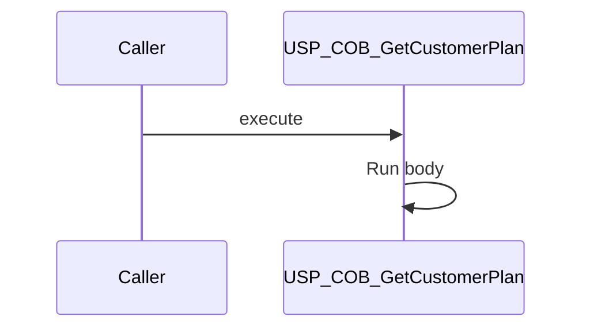
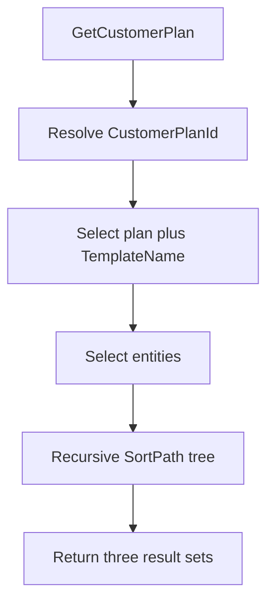

# USP_COB_GetCustomerPlan

## What it does

Returns the customer onboarding plan for one organisation: plan header (with baseline template name), entity rows, and the Module → Activity → Task item tree in depth-first SortOrder path order. Parent Module/Activity Weightage, Status, and PercentComplete are rolled up live from descendant Tasks (N/A tasks count as complete).

## Parameters

| Name | Direction | What it is for |
|---|---|---|
| `@EmployerId` | in | Organisation that owns the plan |

## Call sequence

Calls no other procedures or functions.

## Callers

Procedures and functions that call this object.

No other procedure or function calls this object. Application caller: Core Node `PlannerAuditDAL.getCustomerPlan` via `GET /api/clientonboard2/plan`.

## Nested

Calls no other procedures or functions.

## Steps

1. Resolve `CustomerPlanId` from `TCOB_CustomerPlan` for `@EmployerId`.

2. Return plan header joined to `TCOB_PlanBaselineTemplate.Name` as `TemplateName`.

3. Return `TCOB_CustomerPlanEntity` rows for that plan.

4. Build a recursive SortOrder path over non-removed items and return the tree with live Activity/Module rollups from Task descendants.

## Tables

| Table | Read or write |
|---|---|
| `TCOB_CustomerPlan` | read |
| `TCOB_PlanBaselineTemplate` | read |
| `TCOB_CustomerPlanEntity` | read |
| `TCOB_CustomerPlanItem` | read |

## Unresolved calls

None.

## Flow

