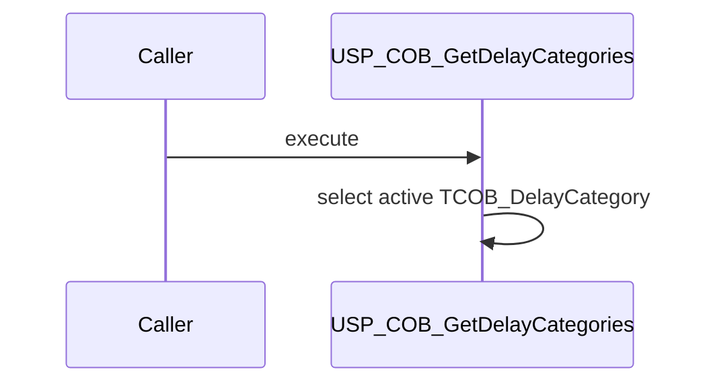
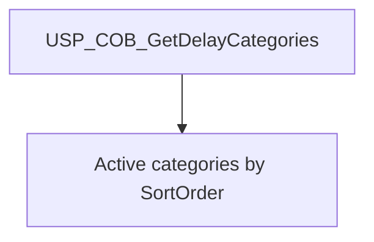

# USP_COB_GetDelayCategories

## What it does

Returns the active Client Onboarding delay taxonomy (`DelayCategoryId`, `Name`, `SortOrder`) for Audit Trail and planner delay filters.

## Parameters

None.

## Call sequence

## Callers

No other procedure or function calls this object. `PlannerAuditDAL.getDelayCategories` executes it for `GET /api/clientonboard2/delay-categories`.

## Nested

Calls no other procedures or functions.

## Steps

1. Select `DelayCategoryId`, `Name`, and `SortOrder` from `TCOB_DelayCategory` where `IsActive = 1`.

2. Order by `SortOrder`.

## Tables

| Table | Read or write |
|---|---|
| `dbo.TCOB_DelayCategory` | read |

## Unresolved calls

None.

## Flow

