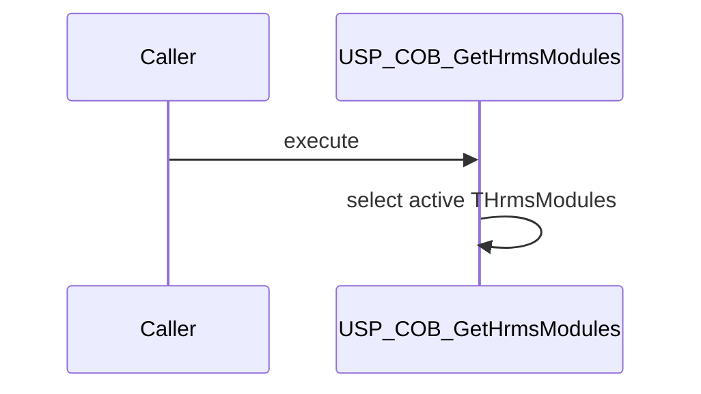
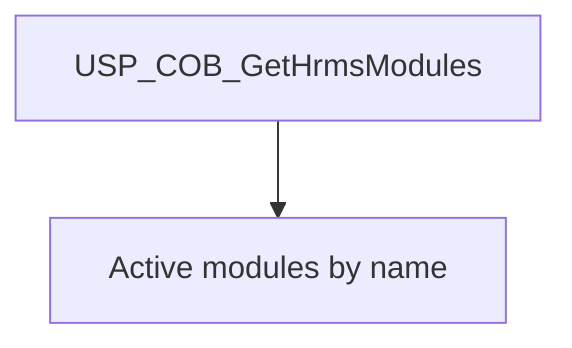

# USP_COB_GetHrmsModules

## What it does

Returns active HRMS modules (`ModuleId`, `ModuleName`) ordered by name for the Client Onboarding Audit Trail module filter dropdown.

## Parameters

None.

## Call sequence

## Callers

No other procedure or function calls this object. `PlannerAuditDAL.getHrmsModules` executes it for `GET /api/clientonboard2/modules`.

## Nested

Calls no other procedures or functions.

## Steps

1. Select `ModuleId` and `ModuleName` from `THrmsModules` where `IsActive = 1`.

2. Order by `ModuleName`.

## Tables

| Table | Read or write |
|---|---|
| `dbo.THrmsModules` | read |

## Unresolved calls

None.

## Flow

