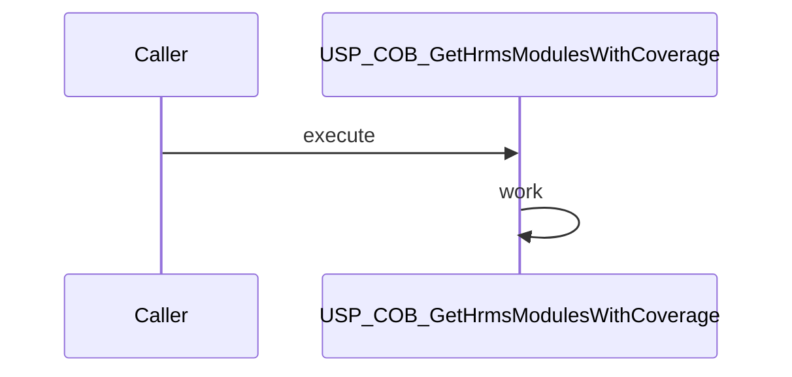
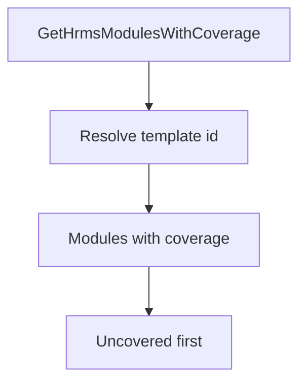

# USP_COB_GetHrmsModulesWithCoverage

## What it does

Lists active THrmsModules with ActivityCount, TaskCount, TotalWeightage, and IsUncovered for a baseline version. Null template id resolves to the active Published baseline.

## Parameters

| Name | Direction | What it is for |
|---|---|---|
| `@BaselineTemplateId` | in | Optional; null uses active Published |

## Call sequence

Calls no other procedures or functions.

## Callers

Procedures and functions that call this object.

No other procedure or function calls this object. App callers are listed in the Plan Templates guide.

## Nested

| Object | Kind | When | Page |
|---|---|---|---|
| *(none)* | — | — | — |

## Steps

1. When `@BaselineTemplateId` is null, pick the active Published template with highest Version.

2. Outer-apply non-removed baseline items per ModuleId.

3. Flag IsUncovered when TaskCount is 0; order uncovered first.

## Tables

| Table | Read or write |
|---|---|
| `dbo.THrmsModules` | read |
| `dbo.TCOB_PlanBaselineTemplate` | read |
| `dbo.TCOB_PlanBaselineItem` | read |

## Unresolved calls

None.

## Flow

