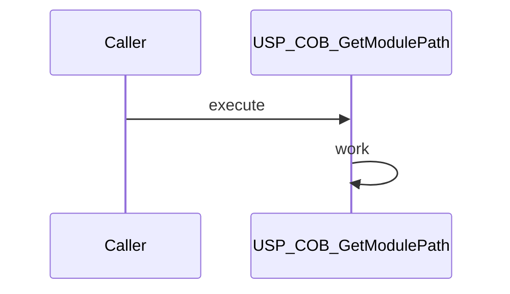
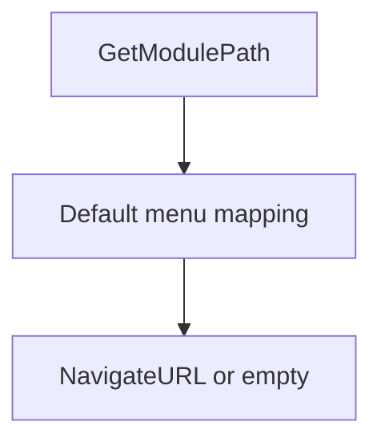

# USP_COB_GetModulePath

## What it does

Returns the default NavigateURL for one active HRMS module via TModuleMenuMapping (IsDefault=1) and employer-0 tMenuDetails. Zero rows means no default path (caller falls back to manual entry).

## Parameters

| Name | Direction | What it is for |
|---|---|---|
| `@ModuleId` | in | HRMS module id |

## Call sequence

Calls no other procedures or functions.

## Callers

Procedures and functions that call this object.

No other procedure or function calls this object. App callers are listed in the Plan Templates guide.

## Nested

| Object | Kind | When | Page |
|---|---|---|---|
| *(none)* | — | — | — |

## Steps

1. Join THrmsModules to default TModuleMenuMapping and employer-0 tMenuDetails.

2. Return TOP 1 NavigateURL for the active module.

## Tables

| Table | Read or write |
|---|---|
| `dbo.THrmsModules` | read |
| `dbo.TModuleMenuMapping` | read |
| `dbo.tMenuDetails` | read |

## Unresolved calls

None.

## Flow

