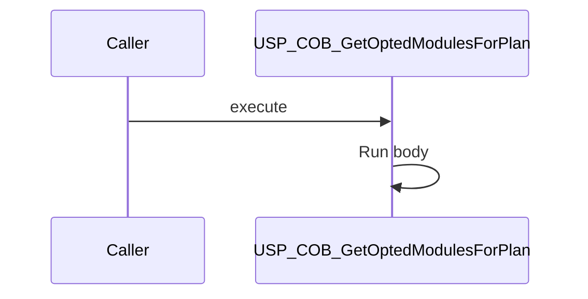
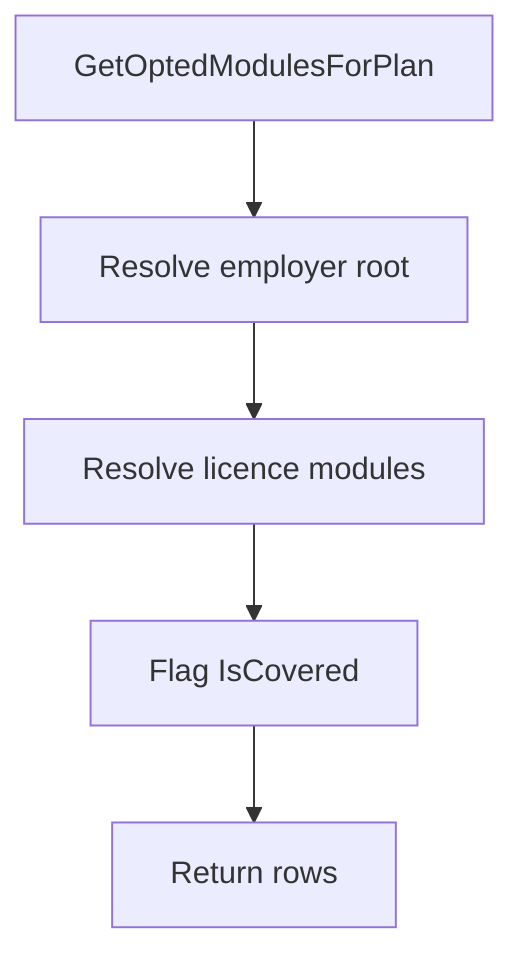

# USP_COB_GetOptedModulesForPlan

## What it does

Lists every module the organisation is opted into (family root licensed `TEmployerModule` / `THrmsModules` / `TLicence`) and flags whether the plan has task items covering that module (`IsCovered`).

## Parameters

| Name | Direction | What it is for |
|---|---|---|
| `@CustomerPlanId` | in | Plan whose employer and coverage are evaluated |

## Call sequence

Calls no other procedures or functions.

## Callers

Procedures and functions that call this object.

No other procedure or function calls this object. Application caller: Core Node `PlannerAuditDAL.getPlanScore` after `USP_COB_GetPlanScore`.

## Nested

Calls no other procedures or functions.

## Steps

1. Resolve employer and root from `TCOB_CustomerPlan`.

2. Resolve active family licence and root employer module rows.

3. Return opted modules with `IsCovered` from plan task items.

## Tables

| Table | Read or write |
|---|---|
| `TCOB_CustomerPlan` | read |
| `TCOB_CustomerPlanItem` | read |
| `TEmployerDetails` | read |
| `TLicence` | read |
| `TEmployerModule` | read |
| `THrmsModules` | read |

## Unresolved calls

None.

## Flow

