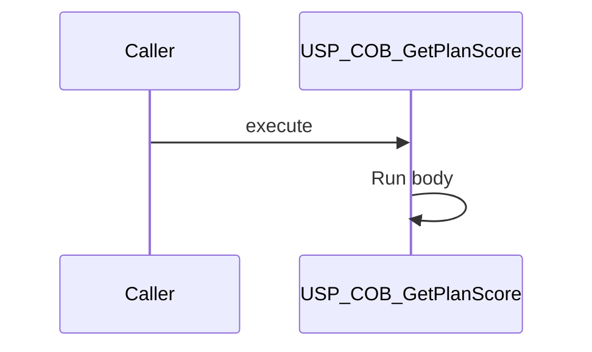
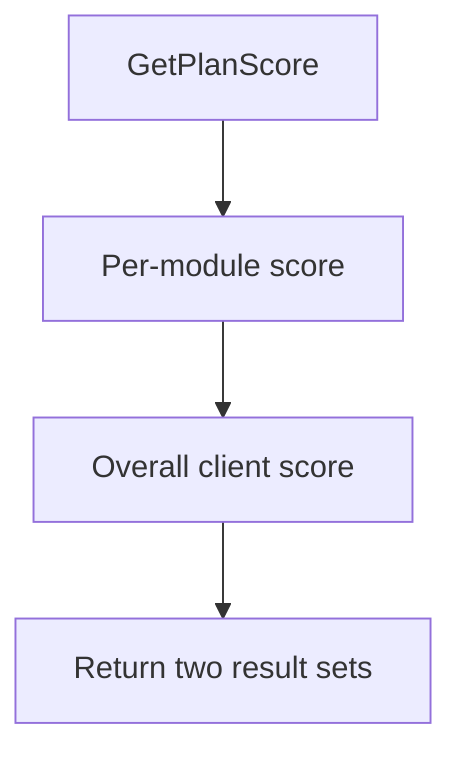

# USP_COB_GetPlanScore

## What it does

Computes weighted module scores and one overall client score from non-removed Task rows. An `IsNA` task counts as 100% complete. A zero-weight scope returns NULL rather than 0.

## Parameters

| Name | Direction | What it is for |
|---|---|---|
| `@CustomerPlanId` | in | Plan to score |

## Call sequence

Calls no other procedures or functions.

## Callers

Procedures and functions that call this object.

No other procedure or function calls this object. Application caller: Core Node `PlannerAuditDAL.getPlanScore` via `GET /api/clientonboard2/plan/score`.

## Nested

Calls no other procedures or functions.

## Steps

1. Aggregate per-`ModuleId` weighted completion for Level = Task, IsRemoved = 0.

2. Aggregate the same formula across all tasks for `ClientScore`.

## Tables

| Table | Read or write |
|---|---|
| `TCOB_CustomerPlanItem` | read |

## Unresolved calls

None.

## Flow

