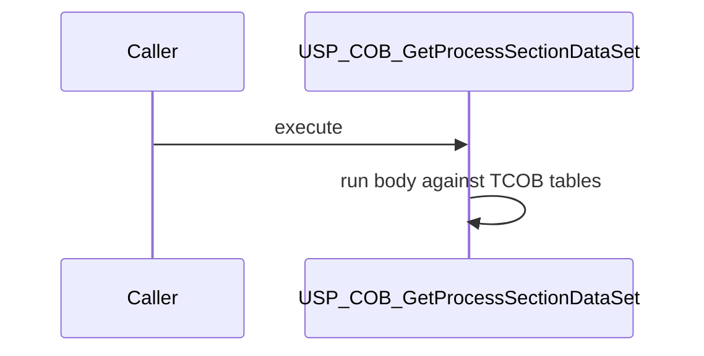
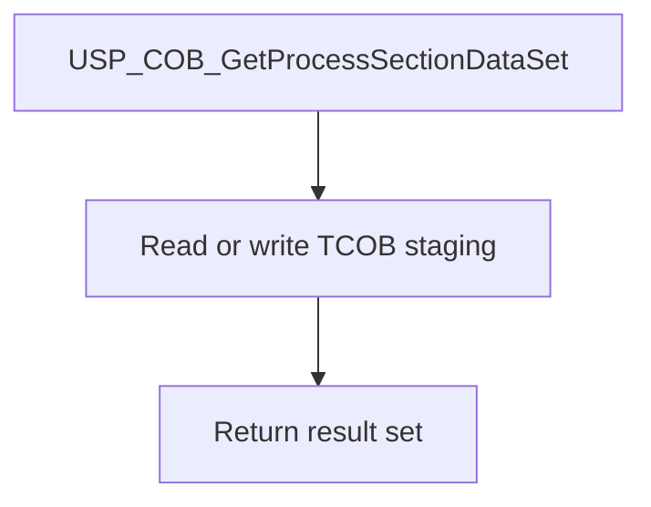

# USP_COB_GetProcessSectionDataSet

## What it does

Returns the staged dataset for one Import Management request section from TCOB_ProcessSectionValues so the queue handler / fetch API can process or display rows.

## Parameters

| Name | Direction | What it is for |
|---|---|---|
| `@RequestID` | in | Required input |
| `@SectionID` | in | Required input |

## Call sequence

Calls no other procedures or functions.

## Callers

Procedures and functions that call this object.

No other procedure or function calls this object. App caller: `ClientOnboardingDAL.fetchSectionDataDetails` from Import Management (`POST /api/clientonboard2/fetchSectionDataDetails`) and queue processing.

## Nested

| Object | Kind | When | Page |
|---|---|---|---|
| *(none)* | — | — | — |

## Steps

1. Select process section values for @RequestID and @SectionID joined to the upload request.

2. Return the Values JSON payload for that section.

## Tables

| Table | Read or write |
|---|---|
| `dbo.TCOB_ProcessSectionValues` | read or write |
| `dbo.TCOB_TemplateUploadRequest` | read or write |

## Unresolved calls

None.

## Flow

