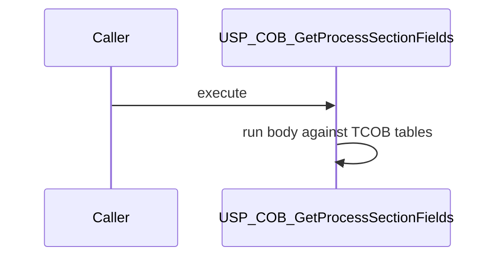
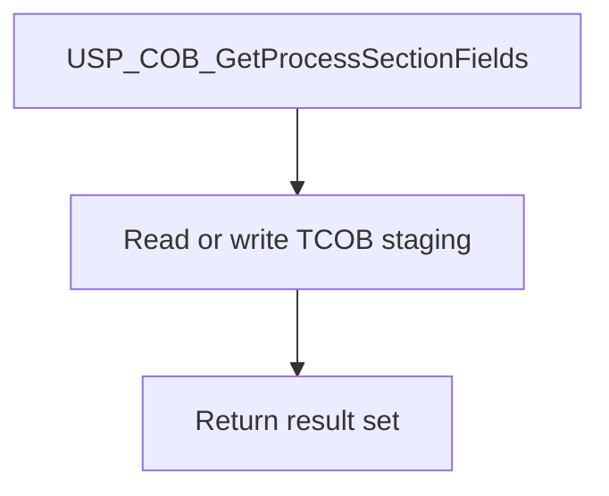

# USP_COB_GetProcessSectionFields

## What it does

Returns the processable field definitions for one Import Management request and template. Unions employee-detail fields (TCOB_EmployeeDetail_Fields) with process-section master fields (TCOB_ProcessSectionMaster_Fields) for client-onboarding sections.

## Parameters

| Name | Direction | What it is for |
|---|---|---|
| `@TemplateID` | in | Required input |
| `@RequestID` | in | Required input |
| `@SectionID` | in | Optional; default NULL |

## Call sequence

Calls no other procedures or functions.

## Callers

Procedures and functions that call this object.

No other procedure or function calls this object. App caller: `ClientOnboardingDAL.getProcessSectionFields` from Import Management (`GET /api/clientonboard2/getProcessSectionFields`) and nested from BLL validateProcessMaster.

## Nested

| Object | Kind | When | Page |
|---|---|---|---|
| *(none)* | — | — | — |

## Steps

1. Select employee-detail fields for active client-onboarding process sections on the request/template, excluding identity-like field names and non-India Country rows unless FieldEntity is not Country.

2. UNION ALL process-section master fields where Default_Value is null.

3. Optional @SectionID filter; otherwise return all sections for the request.

## Tables

| Table | Read or write |
|---|---|
| `dbo.TCOB_TemplateUploadRequest` | read or write |

## Unresolved calls

None.

## Flow

