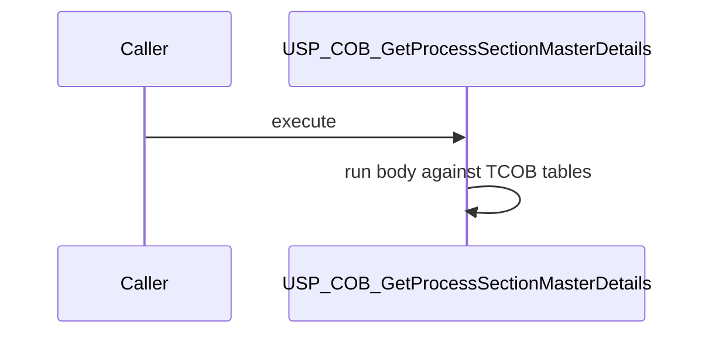
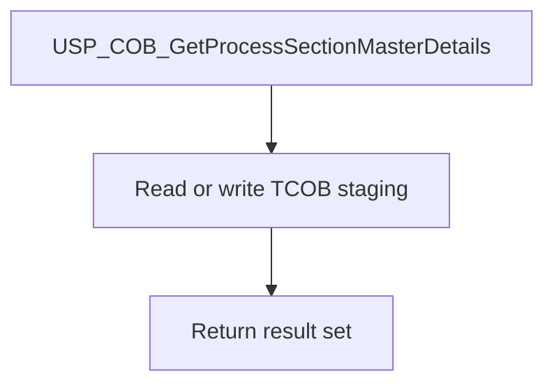

# USP_COB_GetProcessSectionMasterDetails

## What it does

Lists active client-onboarding process section masters with StoredProcName used by the Import Management queue consumer to choose the per-section promote procedure. The Liquibase script begins with `USE [HRM-CL-Prod]`.

## Parameters

| Name | Direction | What it is for |
|---|---|---|
| *(none)* | — | — |

## Call sequence

Calls no other procedures or functions.

## Callers

Procedures and functions that call this object.

No other procedure or function calls this object. App caller: `ClientOnboardingDAL.getProcessSectionMasterDetails` / `getProcessStoredProcedures` from Import Management APIs and ProcessCOBDataSetHandler.

## Nested

| Object | Kind | When | Page |
|---|---|---|---|
| *(none)* | — | — | — |

## Steps

1. Select SectionID, Section, StoredProcName, ProcessMasterExist_SQL from TCOB_ProcessSectionMaster.

2. Filter IsActive = 1 and IsClientOnboardingData = 1.

3. Order by SectionID.

## Tables

| Table | Read or write |
|---|---|
| *(none detected in script joins)* | — |

## Unresolved calls

None.

## Flow

