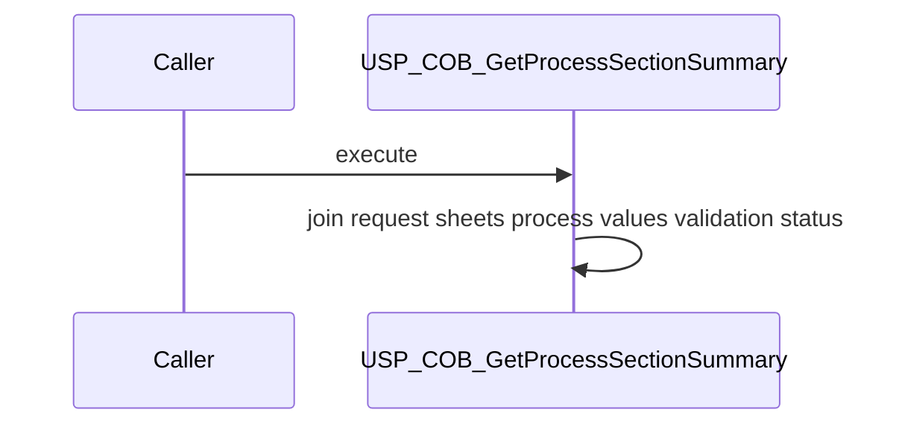
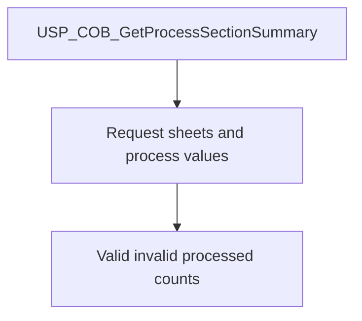

# USP_COB_GetProcessSectionSummary

## What it does

Returns the process-section status grid for one active COB2 upload request. Each row is a section with valid / invalid / duplicate / processed / unprocessed counts, process flag, display order, status text, and comments. Counts come from `TCOB_ProcessSectionValues` joined to optional validation-result and status lookup rows.

## Parameters

| Name | Direction | What it is for |
|---|---|---|
| `@EmployerID` | in | Organisation filter on the upload request |
| `@RequestID` | in | Upload request to summarise |

## Call sequence

Calls no other procedures or functions.

## Callers

Procedures and functions that call this object.

No other procedure or function calls this object. App caller: `ClientOnboardingDAL.getProcessSectionSummary` from Import Management COB2 API (`GET /api/clientonboard2/getProcessSectionSummary`).

## Nested

| Object | Kind | When | Page |
|---|---|---|---|
| *(none)* | — | — | — |

## Steps

1. Script is `HRMS-DATABASE/HRMS/STOREPROCEDURE/USP_COB_GetProcessSectionSummary.sql` (script begins with `USE [HRM-CL-Prod]`).
2. Join active `TCOB_TemplateUploadRequest` through sheet details, template section master, process section master, and process section values.
3. Left join validation results and process status.
4. Filter by `@RequestID` and employer; order by process display order.

## Tables

| Table | Read or write |
|---|---|
| `dbo.TCOB_TemplateUploadRequest` | read |
| `dbo.TCOB_TemplateSheetDetails` | read |
| `dbo.TCOB_TemplateMaster` | read |
| `dbo.TCOB_TemplateSectionMaster` | read |
| `dbo.TCOB_ProcessSectionMaster` | read |
| `dbo.TCOB_ProcessSectionValues` | read |
| `dbo.TCOB_ProcessSectionValidationResults` | read |
| `dbo.TCOB_ProcessStatus` | read |

## Unresolved calls

None.

## Flow

