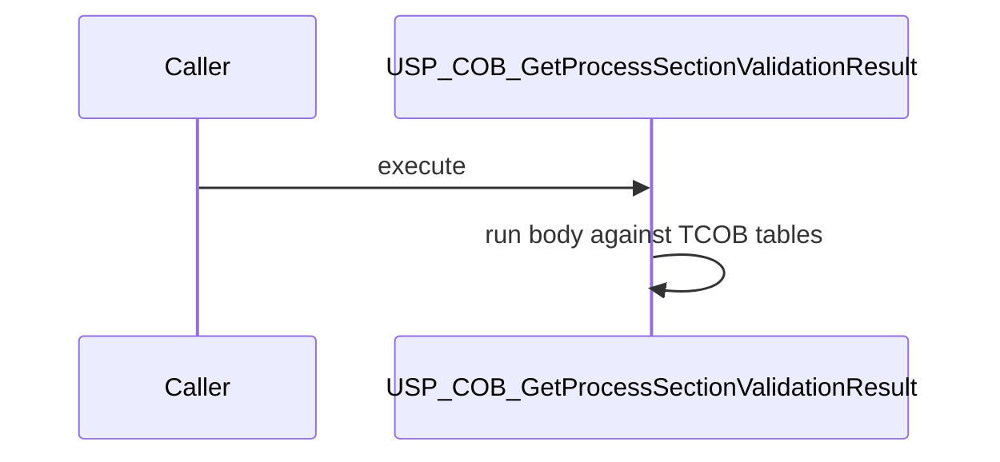
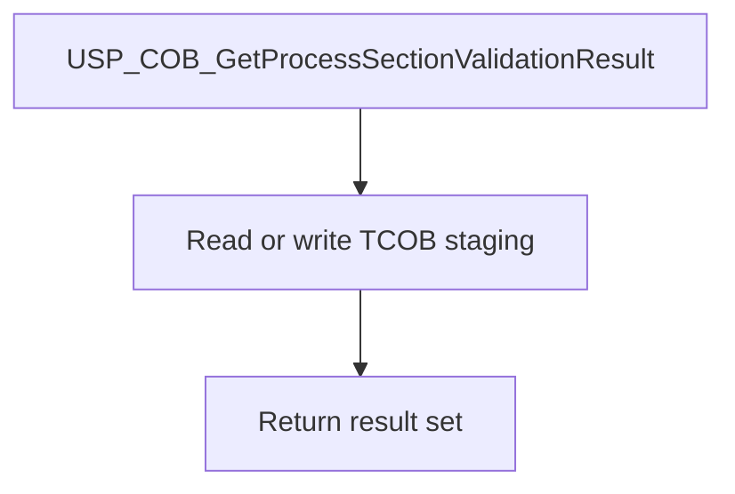

# USP_COB_GetProcessSectionValidationResult

## What it does

Reads validation result rows for one Import Management request (optional section filter) from TCOB_ProcessSectionValidationResults.

## Parameters

| Name | Direction | What it is for |
|---|---|---|
| `@RequestID` | in | Required input |
| `@SectionID` | in | Optional; default NULL |

## Call sequence

Calls no other procedures or functions.

## Callers

Procedures and functions that call this object.

No other procedure or function calls this object. App caller: `ClientOnboardingDAL.getProcessSectionValidationResult` from Import Management (`POST /api/clientonboard2/getProcessSectionValidationResult` and status polling variant).

## Nested

| Object | Kind | When | Page |
|---|---|---|---|
| *(none)* | — | — | — |

## Steps

1. Select validation columns for @RequestID.

2. When @SectionID is supplied, filter to that section; otherwise return all sections ordered by CreateDate descending.

## Tables

| Table | Read or write |
|---|---|
| *(none detected in script joins)* | — |

## Unresolved calls

None.

## Flow

