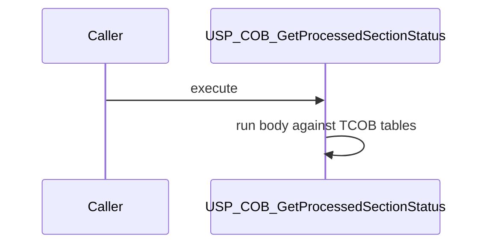
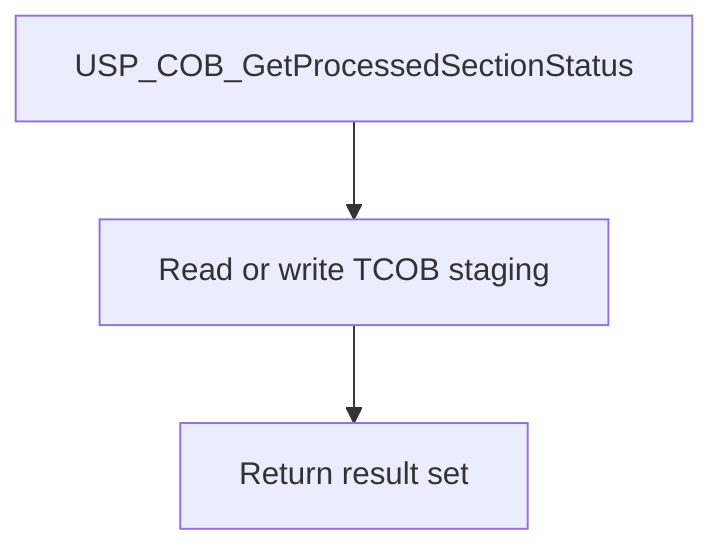

# USP_COB_GetProcessedSectionStatus

## What it does

Returns processed-section status for one Import Management request by reading staged process section values (and related request/template context).

## Parameters

| Name | Direction | What it is for |
|---|---|---|
| `@RequestID` | in | Required input |

## Call sequence

Calls no other procedures or functions.

## Callers

Procedures and functions that call this object.

No other procedure or function calls this object. App caller: `ClientOnboardingDAL.getProcessedSectionStatus` from Import Management (`GET /api/clientonboard2/getProcessedSectionStatus`).

## Nested

| Object | Kind | When | Page |
|---|---|---|---|
| *(none)* | — | — | — |

## Steps

1. Read TCOB_ProcessSectionValues for @RequestID with upload request / template context.

2. Return section process status rows for polling after enqueue.

## Tables

| Table | Read or write |
|---|---|
| `dbo.TCOB_ProcessSectionValues` | read or write |
| `dbo.TCOB_TemplateUploadRequest` | read or write |
| `dbo.TCOB_TemplateMaster` | read or write |

## Unresolved calls

None.

## Flow

