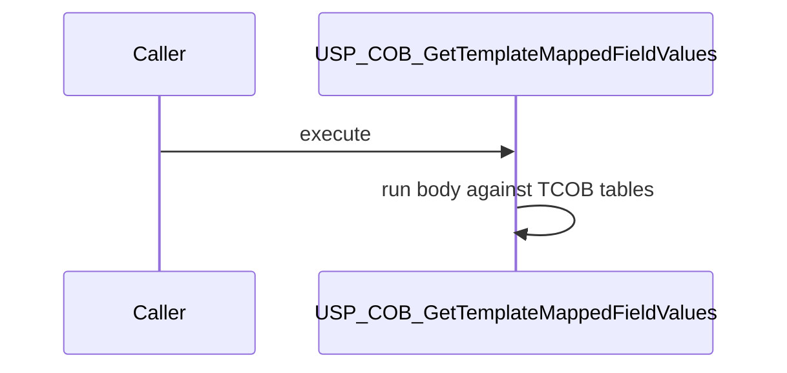
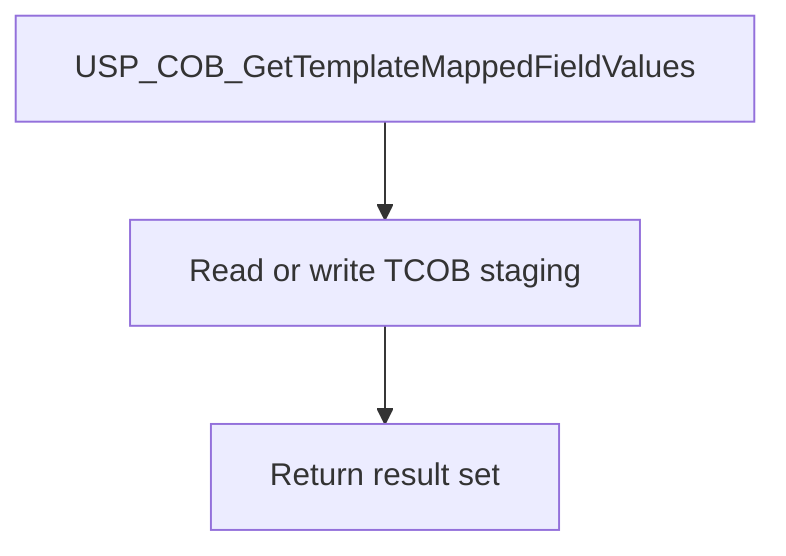

# USP_COB_GetTemplateMappedFieldValues

## What it does

Returns mapped field values for one Import Management request sheet, joining mapping fields to TCOB_TemplateMappingFieldValues.

## Parameters

| Name | Direction | What it is for |
|---|---|---|
| `@TemplateID` | in | Required input |
| `@EmployerID` | in | Required input |
| `@RequestID` | in | Required input |
| `@SheetID` | in | Required input |

## Call sequence

Calls no other procedures or functions.

## Callers

Procedures and functions that call this object.

No other procedure or function calls this object. App caller: `ClientOnboardingDAL.getTemplateMappedFieldValues` from Import Management (`GET /api/clientonboard2/getTemplateMappedFieldValues`).

## Nested

| Object | Kind | When | Page |
|---|---|---|---|
| *(none)* | — | — | — |

## Steps

1. Join template, upload request, sheet details, sections, mapping fields, and field values.

2. Filter by @TemplateID, @EmployerID, @RequestID, and @SheetID.

3. Return field value rows for the mapping UI.

## Tables

| Table | Read or write |
|---|---|
| `dbo.TCOB_TemplateMaster` | read or write |
| `dbo.TCOB_TemplateUploadRequest` | read or write |
| `dbo.TCOB_TemplateSheetDetails` | read or write |
| `dbo.TCOB_TemplateSectionMaster` | read or write |
| `dbo.TCOB_TemplateMappingFields` | read or write |
| `dbo.TCOB_TemplateMappingFieldValues` | read or write |

## Unresolved calls

None.

## Flow

