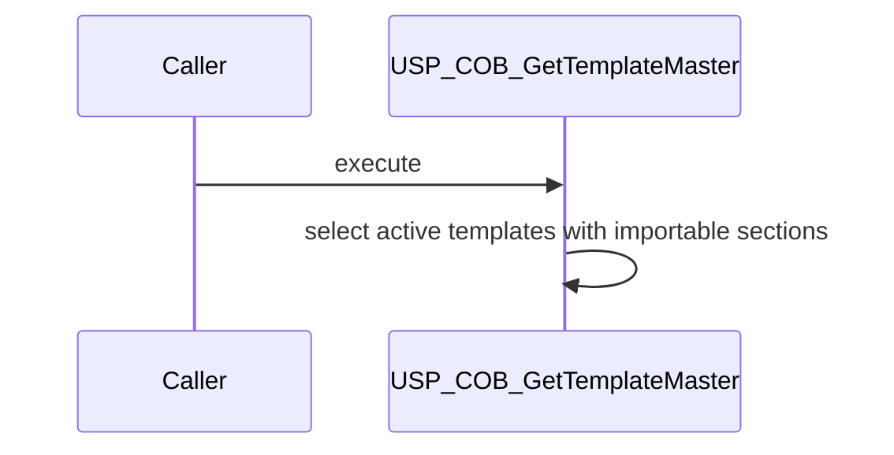
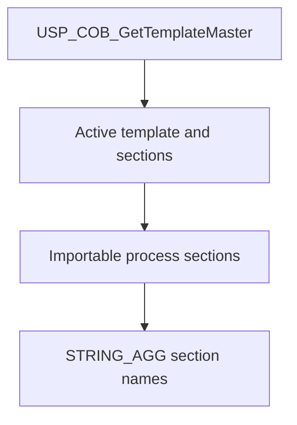

# USP_COB_GetTemplateMaster

## What it does

Returns active Client Onboarding templates that have at least one importable section. Each row is a template id, module, name, and a comma-aggregated list of section names ordered by display order. A section qualifies when its process-section master is marked for client-onboarding data and has either employee-detail fields (system / country 99 / segment) or process-section master fields.

## Parameters

None.

## Call sequence

Calls no other procedures or functions.

## Callers

Procedures and functions that call this object.

No other procedure or function calls this object. App caller: `ClientOnboardingDAL.getClientOnboardingTemplate` from Import Management COB2 API (`GET /api/clientonboard2/getClientOnboardingTemplate`).

## Nested

| Object | Kind | When | Page |
|---|---|---|---|
| *(none)* | — | — | — |

## Steps

1. Script is `HRMS-DATABASE/HRMS/STOREPROCEDURE/USP_COB_GetTemplateMaster.sql`.
2. Join `TCOB_TemplateMaster` to `TCOB_TemplateSectionMaster` where both are active.
3. Keep sections that have an active `TCOB_ProcessSectionMaster` with `IsClientOnboardingData = 1` and either matching `TCOB_EmployeeDetail_Fields` or `TCOB_ProcessSectionMaster_Fields`.
4. Aggregate section names with `STRING_AGG` ordered by `DisplayOrder`, group by template, order by `TemplateID`.

## Tables

| Table | Read or write |
|---|---|
| `dbo.TCOB_TemplateMaster` | read |
| `dbo.TCOB_TemplateSectionMaster` | read |
| `dbo.TCOB_ProcessSectionMaster` | read |
| `dbo.TCOB_EmployeeDetail_Fields` | read |
| `dbo.TCOB_ProcessSectionMaster_Fields` | read |

## Unresolved calls

None.

## Flow

