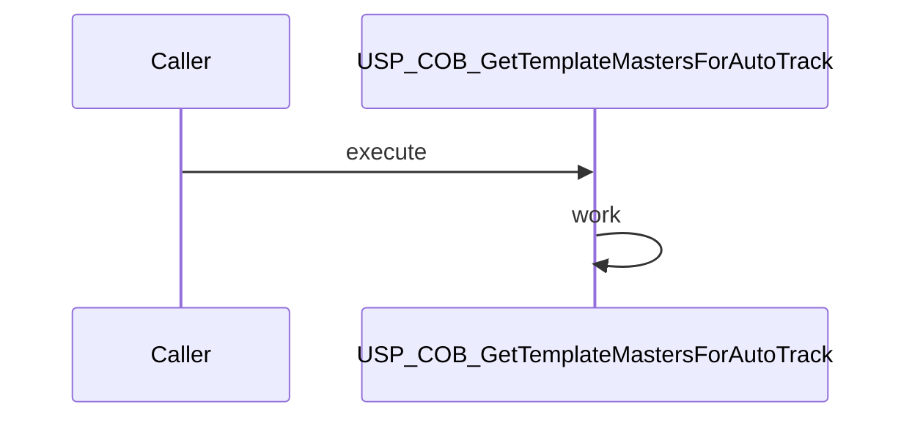
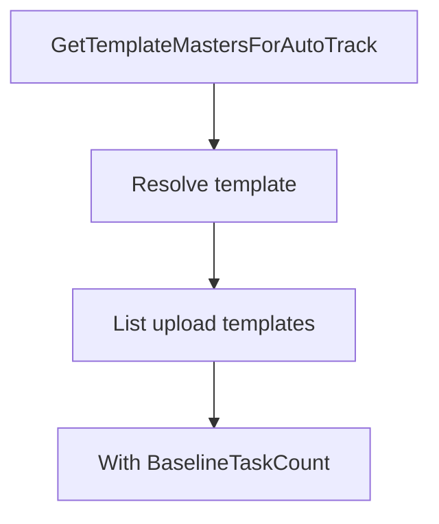

# USP_COB_GetTemplateMastersForAutoTrack

## What it does

Lists COB upload templates for the auto-tracked task picker, with BaselineTaskCount of how many auto-tracked baseline tasks already reference each TemplateId.

## Parameters

| Name | Direction | What it is for |
|---|---|---|
| `@BaselineTemplateId` | in | Optional; null uses active Published |

## Call sequence

Calls no other procedures or functions.

## Callers

Procedures and functions that call this object.

No other procedure or function calls this object. App callers are listed in the Plan Templates guide.

## Nested

| Object | Kind | When | Page |
|---|---|---|---|
| *(none)* | — | — | — |

## Steps

1. Resolve baseline template id to active Published when null.

2. Select TCOB_TemplateMaster rows that are active or already referenced by a live baseline item.

3. Outer-apply BaselineTaskCount for IsAutoTracked items on the resolved template.

## Tables

| Table | Read or write |
|---|---|
| `dbo.TCOB_TemplateMaster` | read |
| `dbo.TCOB_PlanBaselineTemplate` | read |
| `dbo.TCOB_PlanBaselineItem` | read |

## Unresolved calls

None.

## Flow

