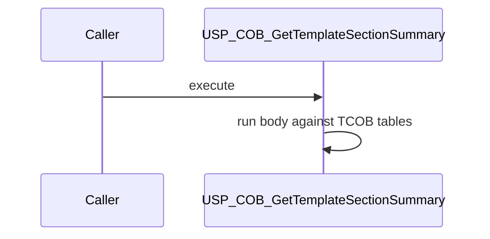
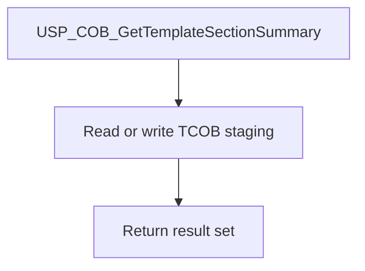

# USP_COB_GetTemplateSectionSummary

## What it does

Returns sheet-level summary for one Import Management request: uploaded sections, mapping presence, field-value counts, process values, and validation results. The Liquibase script begins with `USE [HRM-CL-Prod]`.

## Parameters

| Name | Direction | What it is for |
|---|---|---|
| `@EmployerID` | in | Required input |
| `@RequestID` | in | Required input |

## Call sequence

Calls no other procedures or functions.

## Callers

Procedures and functions that call this object.

No other procedure or function calls this object. App caller: `ClientOnboardingDAL.getTemplateSectionSummary` from Import Management (`GET /api/clientonboard2/getTemplateSectionSummary`).

## Nested

| Object | Kind | When | Page |
|---|---|---|---|
| *(none)* | — | — | — |

## Steps

1. Join upload request, sheet details, template sections, mapping fields/values, process section values, and validation results.

2. Filter by @EmployerID and @RequestID.

3. Return per-sheet summary counts for the mapping wizard.

## Tables

| Table | Read or write |
|---|---|
| `dbo.TCOB_TemplateUploadRequest` | read or write |
| `dbo.TCOB_TemplateSheetDetails` | read or write |
| `dbo.TCOB_TemplateMaster` | read or write |
| `dbo.TCOB_TemplateSectionMaster` | read or write |
| `dbo.TCOB_TemplateStatus` | read or write |
| `dbo.TCOB_TemplateMappingFields` | read or write |
| `dbo.TCOB_TemplateMappingFieldValues` | read or write |
| `dbo.TCOB_ProcessSectionMaster` | read or write |
| `dbo.TCOB_ProcessSectionValues` | read or write |
| `dbo.TCOB_ProcessSectionValidationResults` | read or write |

## Unresolved calls

None.

## Flow

