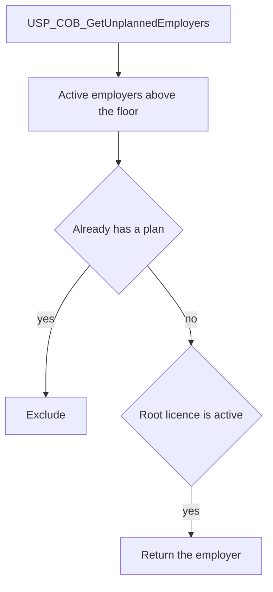

# USP_COB_GetUnplannedEmployers

## What it does

Returns active, not-deleted employers that have no TCOB_CustomerPlan of their own, whose employer id is above the floor, and whose root holds an Active licence that is not soft-deleted. A root argument limits the list to that family.

## Parameters

| Name | Direction | What it is for |
|---|---|---|
| `@MinEmployerId` | in | Only employers with a greater Employerid. Default 0 |
| `@RootEmployerId` | in | Null scans every family. A value limits the scan to that root. Default null |

## Call sequence

Calls no other procedures or functions.

## Callers

Procedures and functions that call this object.

| Object | Kind | Page |
|---|---|---|
| `USP_COB_InstantiatePlanForEmployer` | procedure | [USP_COB_InstantiatePlanForEmployer](/docs/database/hrms/USP_COB_InstantiatePlanForEmployer) |

## Nested

Calls no other procedures or functions.

## Steps

1. Select EmployerId, EmployerName, ParentEmployerId, and RootEmployerId from TEmployerDetails.

2. Keep IsActive 1, isdeleted 0, and Employerid greater than @MinEmployerId.

3. When @RootEmployerId is not null, keep rows whose root, or whose own id when the root is null or 0, equals that value.

4. Exclude employers that already have a TCOB_CustomerPlan row. Require an Active, not soft-deleted TLicence on the root.

## Tables

| Table | Read or write |
|---|---|
| `TEmployerDetails` | read |
| `TCOB_CustomerPlan` | read |
| `TLicence` | read |

## Flow

