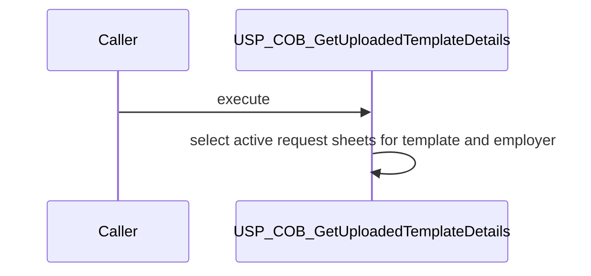
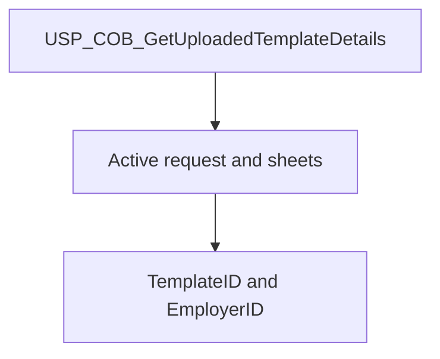

# USP_COB_GetUploadedTemplateDetails

## What it does

Lists sheet rows for the active COB2 upload request for one template and employer. Each row includes request id, request name, sheet id, section name, sheet JSON, and the request’s active / enable step ids, ordered by section display order.

## Parameters

| Name | Direction | What it is for |
|---|---|---|
| `@TemplateID` | in | Template to load |
| `@EmployerID` | in | Organisation that owns the request |

## Call sequence

Calls no other procedures or functions.

## Callers

Procedures and functions that call this object.

No other procedure or function calls this object. App caller: `ClientOnboardingDAL.getUploadedTemplateDetails` from Import Management COB2 API (`GET /api/clientonboard2/getUploadedTemplateDetails`).

## Nested

| Object | Kind | When | Page |
|---|---|---|---|
| *(none)* | — | — | — |

## Steps

1. Script is `HRMS-DATABASE/HRMS/STOREPROCEDURE/USP_COB_GetUploadedTemplateDetails.sql`.
2. Join active `TCOB_TemplateMaster` to active `TCOB_TemplateUploadRequest`, `TCOB_TemplateSheetDetails`, and `TCOB_TemplateSectionMaster`.
3. Filter by `@TemplateID` and `@EmployerID`.
4. Order by `TSM.DisplayOrder`.

## Tables

| Table | Read or write |
|---|---|
| `dbo.TCOB_TemplateMaster` | read |
| `dbo.TCOB_TemplateUploadRequest` | read |
| `dbo.TCOB_TemplateSheetDetails` | read |
| `dbo.TCOB_TemplateSectionMaster` | read |

## Unresolved calls

None.

## Flow

