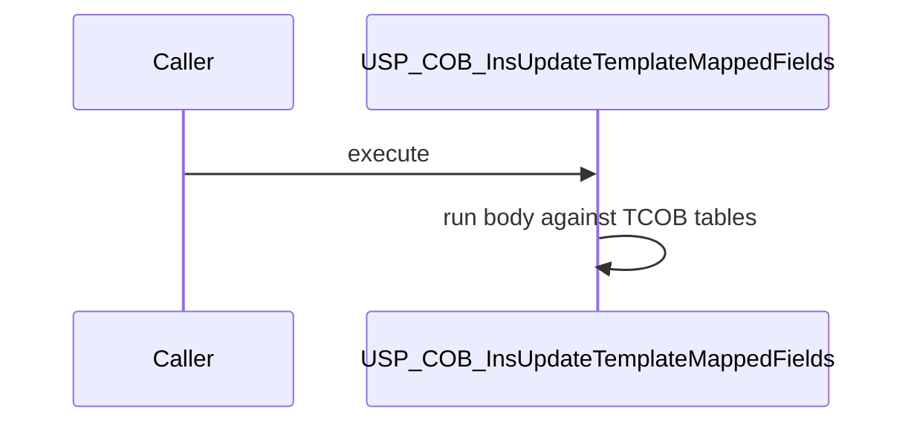
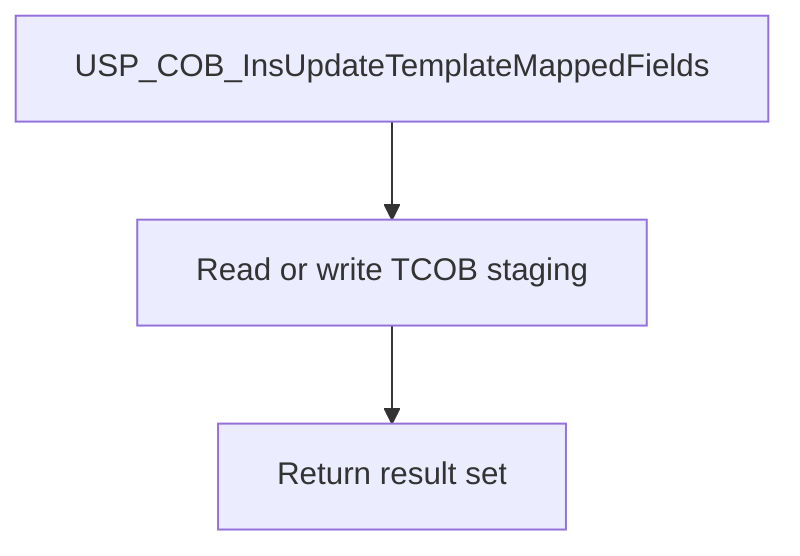

# USP_COB_InsUpdateTemplateMappedFields

## What it does

Inserts or updates one sheet field-mapping row for an Import Management request. On first insert for all sheets of the request, advances ActiveStep to Map Fields on TCOB_TemplateUploadRequest.

## Parameters

| Name | Direction | What it is for |
|---|---|---|
| `@MappingFieldID` | in | Optional; default NULL |
| `@RequestID` | in | Required input |
| `@SheetID` | in | Required input |
| `@FieldInfo` | in | Required input |
| `@FieldValueInfo` | in | Required input |
| `@CreatedBy` | in | Required input |

## Call sequence

Calls no other procedures or functions.

## Callers

Procedures and functions that call this object.

No other procedure or function calls this object. App caller: `ClientOnboardingDAL.insertUpdateTemplateMappedFields` from Import Management (`POST /api/clientonboard2/insertUpdateTemplateMappedFields`).

## Nested

| Object | Kind | When | Page |
|---|---|---|---|
| *(none)* | — | — | — |

## Steps

1. Resolve Map Fields step id from TCOB_TemplateStatus.

2. When @MappingFieldID is null/0, insert into TCOB_TemplateMappingFields and optionally update request ActiveStep when every sheet has a mapping.

3. Otherwise update FieldInfo for the matching MappingFieldID / RequestID / SheetID, or return ErrorCode 1 when mapping does not exist.

4. Return MappingFieldID.

## Tables

| Table | Read or write |
|---|---|
| `dbo.TCOB_TemplateStatus` | read or write |
| `dbo.TCOB_TemplateMappingFields` | read or write |
| `dbo.TCOB_TemplateSheetDetails` | read or write |
| `dbo.TCOB_TemplateUploadRequest` | read or write |

## Unresolved calls

None.

## Flow

