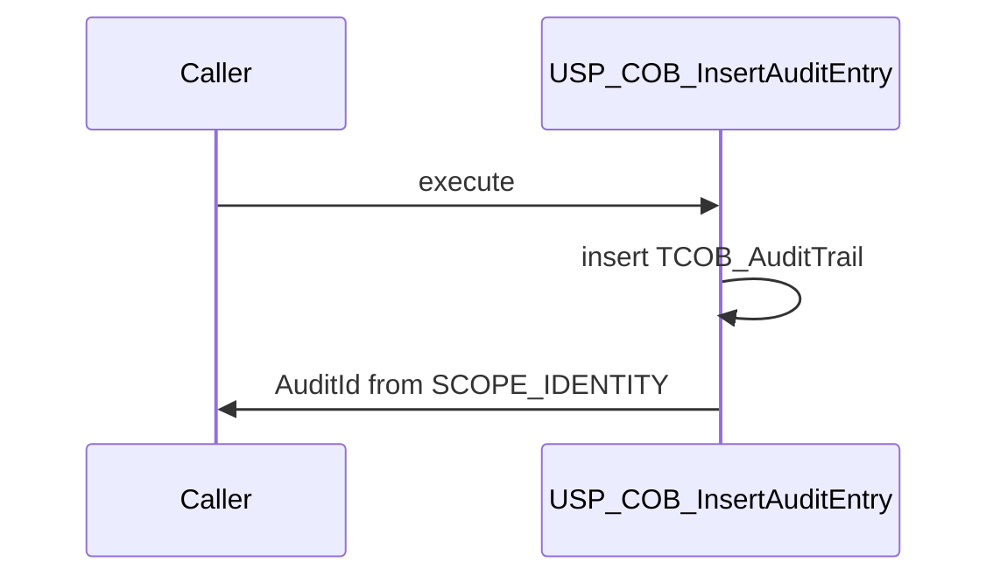
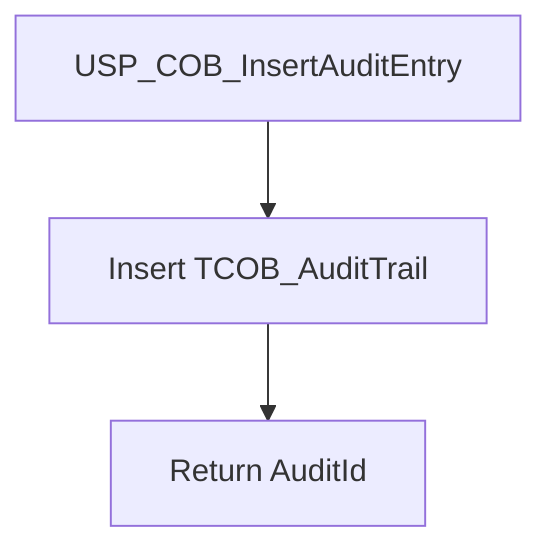

# USP_COB_InsertAuditEntry

## What it does

Appends one row to `TCOB_AuditTrail` and returns the new `AuditId`. Used by the Audit Trail manual API and by PlannerAudit BLL field-level diffs. Many other COB planner procedures insert into the same table directly and do not call this procedure.

## Parameters

| Name | Direction | What it is for |
|---|---|---|
| `@CustomerPlanId` | in | Optional plan id |
| `@PlanItemId` | in | Optional plan item id |
| `@EmployerId` | in | Optional employer id |
| `@EventType` | in | Required event type |
| `@EventSource` | in | Source such as `Manual`, `COBAuto`, or `System` |
| `@OldStatus` | in | Optional previous status |
| `@NewStatus` | in | Optional new status |
| `@DelayCategoryId` | in | Optional delay category |
| `@Remark` | in | Optional remark |
| `@EvidenceLink` | in | Optional evidence URL |
| `@ActorEmployeeId` | in | Optional actor employee id |
| `@RelatedRequestId` | in | Optional related COB request id |
| `@FieldName` | in | Optional field name for field-level tracking |
| `@OldValue` | in | Optional old field value |
| `@NewValue` | in | Optional new field value |

## Call sequence

## Callers

No other procedure or function calls this object. `PlannerAuditDAL.insertAuditEntry` executes it for `POST /api/clientonboard2/audit/manual` (EventSource forced to `Manual` in BLL) and for field-change inserts from plan-item update / reweight BLL paths.

## Nested

Calls no other procedures or functions.

## Steps

1. Insert one `TCOB_AuditTrail` row with the supplied columns. `EventAtUtc` defaults via the table constraint.

2. Select `CAST(SCOPE_IDENTITY() AS BIGINT) AS AuditId`.

## Tables

| Table | Read or write |
|---|---|
| `dbo.TCOB_AuditTrail` | write |

## Unresolved calls

None.

## Flow

