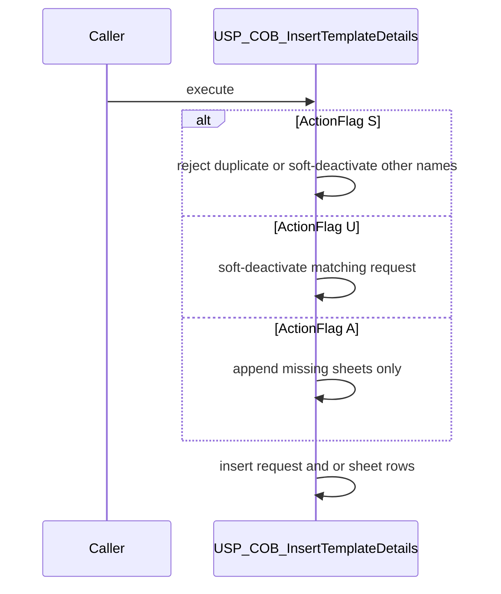
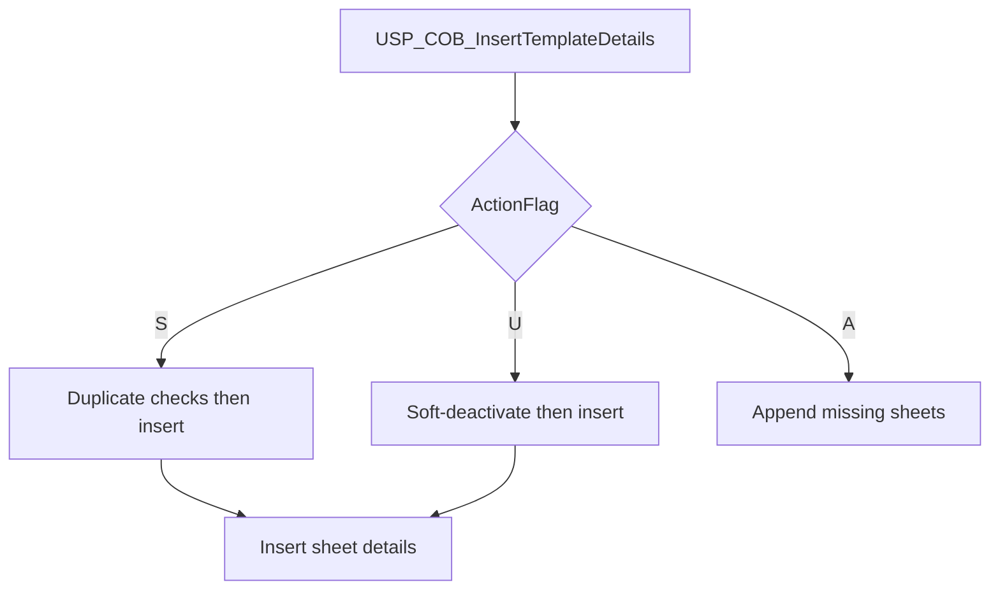

# USP_COB_InsertTemplateDetails

## What it does

Creates or updates a COB2 workbook upload request for one employer and template. Action flag `S` inserts a new active request (after duplicate-name and sheet-name checks, and soft-deactivating other active requests for the same template). Flag `U` soft-deactivates the matching request then inserts fresh. Flag `A` appends only missing sheets onto an existing active request. Sheet rows are built from `@SheetInfo` JSON joined to `TCOB_TemplateSectionMaster`.

## Parameters

| Name | Direction | What it is for |
|---|---|---|
| `@TemplateID` | in | Template from `TCOB_TemplateMaster` |
| `@RequestTemplateName` | in | Workbook / request display name |
| `@EmployerID` | in | Organisation for the request |
| `@SheetInfo` | in | JSON array of sheet name + sheet payload |
| `@ActionFlag` | in | `S` save, `U` update, `A` append |
| `@CreatedBy` | in | Actor stored on insert / update |

## Call sequence

Calls no other procedures or functions.

## Callers

Procedures and functions that call this object.

No other procedure or function calls this object. App caller: `ClientOnboardingDAL.insertOrUpdateTemplateDetails` from Import Management COB2 API (`POST /api/clientonboard2/insertOrUpdateTemplateDetails`).

## Nested

| Object | Kind | When | Page |
|---|---|---|---|
| *(none)* | — | — | — |

## Steps

1. Script is `HRMS-DATABASE/HRMS/STOREPROCEDURE/USP_COB_InsertTemplateDetails.sql`.
2. Resolve `@ActiveStep` from `TCOB_TemplateStatus` where `StepName = 'Map Fields'`.
3. For `S`, return error 1 if the same employer/template/name is already active; soft-deactivate other active names for the template; validate every sheet name against `TCOB_TemplateSectionMaster`.
4. For `U`, soft-deactivate the matching active request then fall through to insert.
5. For `A`, require an existing active request, reject duplicate sheet names (error 4), insert only new `TCOB_TemplateSheetDetails` rows, return.
6. Otherwise insert `TCOB_TemplateUploadRequest` and sheet detail rows from `OPENJSON(@SheetInfo)`; return `RequestID`.

## Tables

| Table | Read or write |
|---|---|
| `dbo.TCOB_TemplateStatus` | read |
| `dbo.TCOB_TemplateUploadRequest` | read, write |
| `dbo.TCOB_TemplateSectionMaster` | read |
| `dbo.TCOB_TemplateSheetDetails` | read, write |

## Unresolved calls

None. Sheet parsing uses `OPENJSON` (built-in).

## Flow

