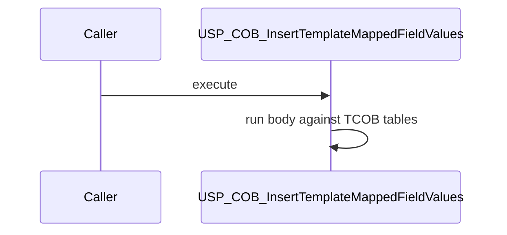
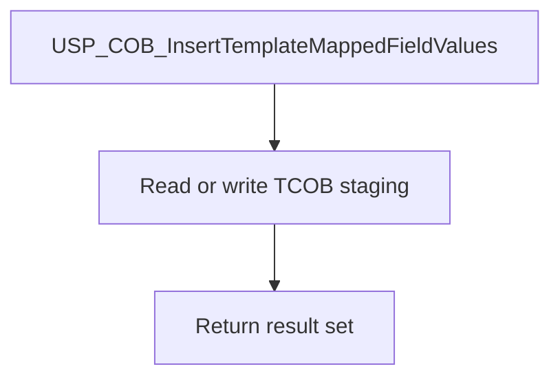

# USP_COB_InsertTemplateMappedFieldValues

## What it does

Inserts mapped field value rows for one mapping field into TCOB_TemplateMappingFieldValues from @FieldValueInfo JSON.

## Parameters

| Name | Direction | What it is for |
|---|---|---|
| `@MappingFieldID` | in | Required input |
| `@FieldValueInfo` | in | Required input |
| `@CreatedBy` | in | Required input |

## Call sequence

Calls no other procedures or functions.

## Callers

Procedures and functions that call this object.

No other procedure or function calls this object. App caller: `ClientOnboardingDAL.insertTemplateMappedFieldValues` from Import Management (`POST /api/clientonboard2/insertTemplateMappedFieldValues`).

## Nested

| Object | Kind | When | Page |
|---|---|---|---|
| *(none)* | — | — | — |

## Steps

1. Parse @FieldValueInfo and insert rows into TCOB_TemplateMappingFieldValues for @MappingFieldID.

2. Stamp CreatedBy / CreateDate from @CreatedBy.

## Tables

| Table | Read or write |
|---|---|
| `dbo.TCOB_TemplateMappingFieldValues` | read or write |

## Unresolved calls

None.

## Flow

