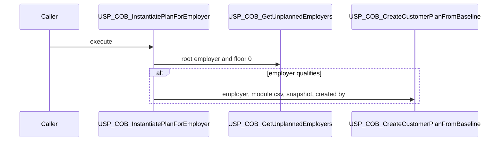
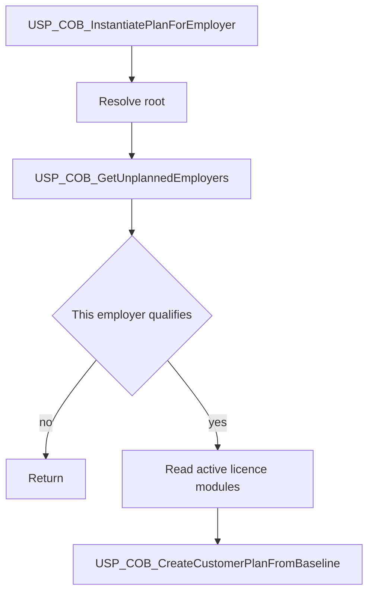

# USP_COB_InstantiatePlanForEmployer

## What it does

Creates a client-onboarding plan for exactly one organisation. It asks USP_COB_GetUnplannedEmployers whether that organisation qualifies, then builds a licence snapshot from the root's active licence modules and passes it to USP_COB_CreateCustomerPlanFromBaseline. A new parent with no licence returns no rows.

## Parameters

| Name | Direction | What it is for |
|---|---|---|
| `@EmployerId` | in | Organisation to plan |
| `@CreatedBy` | in | User stored on the plan. Default null |

## Call sequence

## Callers

Procedures and functions that call this object.

No other procedure or function calls this object.

## Nested

| Object | Kind | When | Page |
|---|---|---|
| `USP_COB_GetUnplannedEmployers` | procedure | eligibility for this root family, with MinEmployerId 0 | [USP_COB_GetUnplannedEmployers](/docs/database/hrms/USP_COB_GetUnplannedEmployers) |
| `USP_COB_CreateCustomerPlanFromBaseline` | procedure | the employer is in the candidate list | [USP_COB_CreateCustomerPlanFromBaseline](/docs/database/hrms/USP_COB_CreateCustomerPlanFromBaseline) |

## Steps

1. Read RootEmployerId from TEmployerDetails, using the employer id itself when the root is null or 0. Return when the employer does not exist.

2. Insert the result of USP_COB_GetUnplannedEmployers for that root and MinEmployerId 0. Return when this employer is not in the list.

3. Read the latest Active, not soft-deleted TLicence for the root.

4. Build module id and name lists from TEmployerModule joined to THrmsModules for that licence id. The comment says this join matches the licence list and does not filter IsActive.

5. Build LicenseSnapshotJson with moduleIds, moduleNames, and capturedAt.

6. Execute USP_COB_CreateCustomerPlanFromBaseline for this employer only.

## Tables

| Table | Read or write |
|---|---|
| `TEmployerDetails` | read |
| `TLicence` | read |
| `TEmployerModule` | read |
| `THrmsModules` | read |

## Flow

