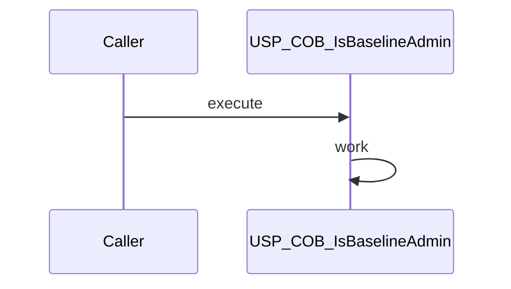
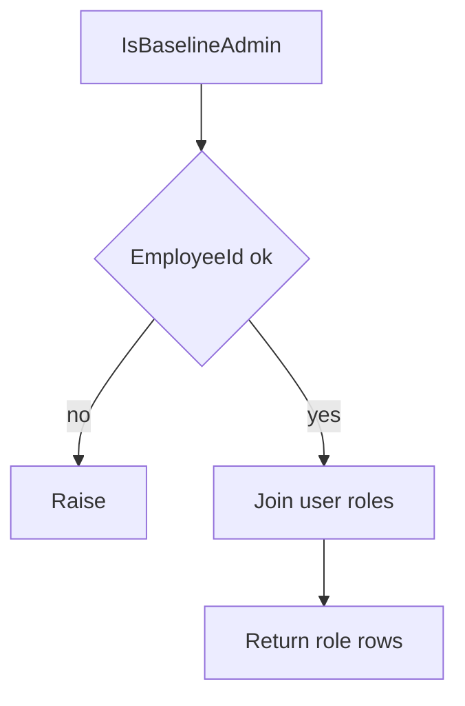

# USP_COB_IsBaselineAdmin

## What it does

Returns every active HRMS role for one employee so Plan Builder middleware can decide ADMINISTRATOR entitlement. Policy stays in baselineAdminMiddleware.js; this procedure only resolves role facts via TEmployee to TUserEmployee to TUsers to TRoles.

## Parameters

| Name | Direction | What it is for |
|---|---|---|
| `@EmployeeId` | in | Logged-in employee id (req.EID) |

## Call sequence

Calls no other procedures or functions.

## Callers

Procedures and functions that call this object.

No other procedure or function calls this object. App callers are listed in the Plan Templates guide.

## Nested

| Object | Kind | When | Page |
|---|---|---|---|
| *(none)* | — | — | — |

## Steps

1. Raise COB_SCOPE_REQUIRED when `@EmployeeId` is null or <= 0.

2. Join employee to active users and active roles; return RoleId, RoleName, normalised RoleType, IsGlobalAccess, UserId.

3. Return zero or more rows; middleware treats empty as not admin and any ADMINISTRATOR RoleType as allowed.

## Tables

| Table | Read or write |
|---|---|
| `dbo.TEmployee` | read |
| `dbo.TUserEmployee` | read |
| `dbo.TUsers` | read |
| `dbo.TRoles` | read |

## Unresolved calls

None.

## Flow

