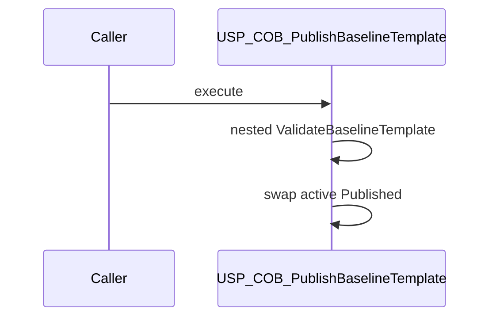
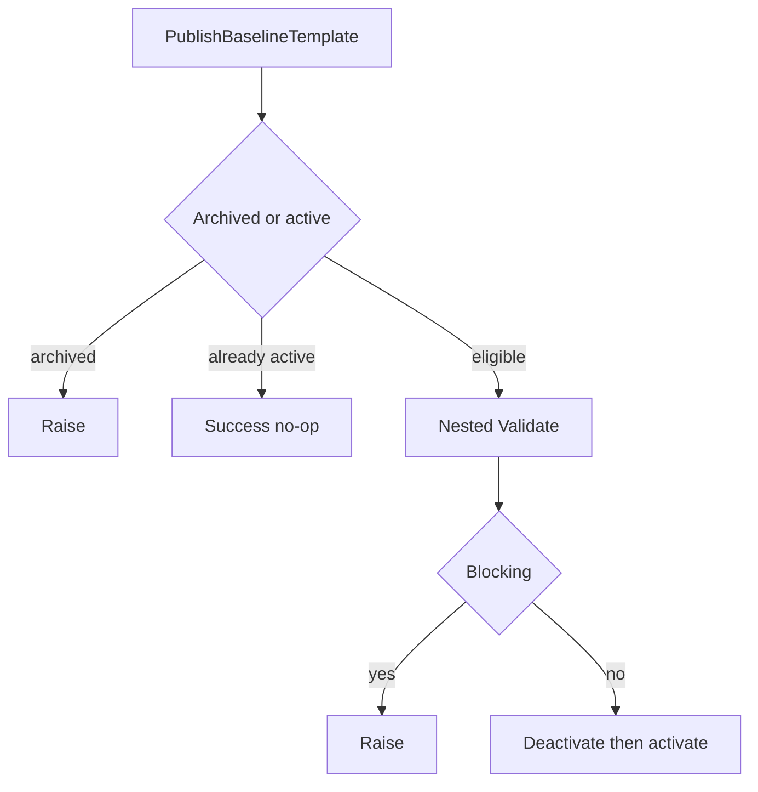

# USP_COB_PublishBaselineTemplate

## What it does

Promotes a Draft (or inactive Published) to Published+active after nested validation. Deactivates the previous active row in one transaction. Already-active Published is an idempotent success. Does not change existing customer plans.

## Parameters

| Name | Direction | What it is for |
|---|---|---|
| `@BaselineTemplateId` | in | Version to publish |
| `@RowVersion` | in | Optional concurrency stamp |
| `@PublishedBy` | in | Actor |

## Call sequence

See Nested for procedures this object calls.

## Callers

Procedures and functions that call this object.

No other procedure or function calls this object. App callers are listed in the Plan Templates guide.

## Nested

| Object | Kind | When | Page |
|---|---|---|---|
| `USP_COB_ValidateBaselineTemplate` | procedure | Always before status change | [USP_COB_ValidateBaselineTemplate](/docs/database/hrms/USP_COB_ValidateBaselineTemplate) |

## Steps

1. Refuse Archived; no-op success when already Published and active.

2. Optional RowVersion conflict check.

3. INSERT EXEC USP_COB_ValidateBaselineTemplate; raise COB_VALIDATION_FAILED when any Blocking row exists.

4. Deactivate other active templates, then set this row Published IsActive=1.

## Tables

| Table | Read or write |
|---|---|
| `dbo.TCOB_PlanBaselineTemplate` | read and write |
| `dbo.TCOB_PlanBaselineItem` | read via nested validate |

## Unresolved calls

None.

## Flow

